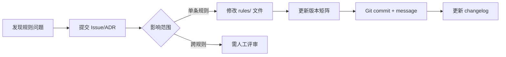

# AGENTS.md v4.22.0 - 个人开发者精简版

> **版本**: v4.22.0 | **更新**: 2026-11-17 | **许可**: MIT
> **变更说明（v4.22.0）**: **多 AI 协作任务跟踪（跨工具并发开发 · 文件即真源）**：① `collaboration` v1.6.0 新增 §2.6 跨 AI 任务台账（三纪律：开工先查台账 / 收工必写台账 / 一任务一 worktree；五段契约：frontmatter / 目标与验收 / 写范围 / 认领记录 / 进展日志 + 交接状态）；② §2 入口路由新增「多 AI 协作任务跟踪 / 多工具并发开发」场景；③ 配套 example-workspace 工作区级台账 `outputs/任务台账/`（README + INDEX 派生 + 任务模板 + 零依赖看板脚本 `tools/gen-task-board.mjs`，`--selftest` 正负自证 + `--check`）与经验库 `outputs/知识库/`（四类知识分层，仅收第四类经验/踩坑，与 RULE-057 `docs/learning/` 单仓笔记互补）；④ 各仓 AGENTS.md（ai/qms/eval）收工节拍加「更新工作区级任务台账」强制步。起因：工作区 5+ 个 AI 工具并发开发，任务状态散在私有会话互不可见（`ai/PROGRESS.md` 快照 / `.box-agent/task-registry` 私有格式），重复劳动与「AI 自称完成」风险。
> **变更说明（v4.20.0）**: **行为层合规补强（起因：2026-11-14 违规根因分析——3 天 38 次门禁绕行、主检出 4 天失守、73 篇产物不落库、RULE-057 单侧断裂）**：① `branch-strategy` v1.2.0 新增 §0.1 主检出权与合并操作台（主检出默认停 main / 离开须归还；main 操作台专用 worktree 用完即删或 plumbing 合并留痕；`--no-checkout`+按需物化降摩擦；占用仲裁；豁免计量）；② `root-directory-hygiene` v2.1.0 新增 §3.1 门禁红处置协议（FAIL 后三选一处置且须在下一 commit 前完成；禁止 --no-verify 绕过结构类门禁；无主违规物由接手代理处置；同日同因豁免 ≥3 即缺陷信号）；③ `git-conventions` v1.2.0 新增 Agent 归属 trailer（所有提交含 merge 带 `Agent: <工具>-<角色>`，恢复多工具归因与授权链）；④ `collaboration` v1.5.0 §2.5 增任务级互斥（同 spec 并行实例 ≤1，派发前查在途）；⑤ `directory-structure` v1.6.0 修正 §7.1 命名自相矛盾（日期段改与分支规范一致 MMDD，历史全日期名视为合规存量）+ L3 表新增提交载体条款（落盘即须随收尾 commit 入库）；⑥ 两仓 AGENTS.md 收工节拍升四步（合回 main + push 必须成功 + 学习笔记与功能同 commit + worktree 清点/收工纪要）；⑦ 新增观察期门禁 `hooks/scripts/branch-hygiene-check.mjs`（主检出占用 / 豁免计数 / trailer / 工作面数，WARN-only，`--selftest` 自证，登记 gate-inventory not-integrated）+ gate-inventory 增观察期毕业规则（observe 条目默认 30 天评审期，禁止无限观察）。
> **变更说明（v4.17.0）**: **生成任务查重 / Look Before You Write**（并入 RULE-053 §3.5，不新增 RULE 编号）：任何产出新文件的生成任务，动手前必须先检索同主题已有产物；命中即**就地修改或指针化**，检索为空才允许新建；带编号的受控文档一主题只允许一份正文真源，HTML / 图表是派生呈现层。配套观察期门禁 `hooks/scripts/duplicate-artifact-check.mjs`（WARN only，未挂硬拦截），并改造 `workflow-html` v1.1.0 / `workflow-design` v1.3.0 / `html-document-center` v1.1.0 / `docs-author` 输入契约。起因：example-workspace 重复审计发现同主题层层新建（`outputs/` 三份执行报告、两份评估文档），冻结仓与 worktree 副本按 §3.5 列为合法例外。
> **变更说明（v4.16.0）**: **引入规范驱动开发（SDD / SSD，ADR-008）**：新增 **RULE-055 `rules/spec-driven.md`**（规格锚定、WHAT≠HOW、澄清门禁、规格—代码绑定、体量纪律）与 **RULE-056 `rules/spec-kit.md`**（Spec-Kit 八步 / Kiro 三文件流程镜像，**不引入 `specify-cli`**）；配套 `templates/spec/{spec,plan,tasks}-template.md` 与零依赖门禁 `hooks/scripts/spec-clarity-gate.mjs`（澄清清零 / 结构完整 / ≤200 行 / 漂移 / FR 覆盖，`--selftest` 正负双向自证 + CRLF 兼容，挂 `rules/gate.sh` 第 5 步与 `gate-inventory.yaml`）。**按 L0–L3 分级适用**：L0/L1 不落盘规格（对话内轻量规格），L2 落 `docs/tasks/<id>/spec.md`，L3 另加 `design.md`；**明确拒绝 spec-as-source 与全仓强制 SDD**（Markdown 瀑布已被社区实证）。链路改造：`workflow-core` v1.3.0（步骤 1.5d 审批同时覆盖 spec）、`workflow-design` v1.2.0（新增规格阶段与六必填段）、`collaboration` v1.3.0（规格优先 / 随代码同步 / 澄清不猜 + spec 分级表）、`testing-rules` v1.1.3（TDD RED 用例译自 spec 验收场景）、`anti-patterns` v1.2.0（SDD 特有反模式 8 条）、`directory-structure` v1.3.2（L3 落点 + docs 树新增 `tasks/`）；技能侧 `brainstorming` v2.2.0（步骤 5.5 规格化）、`writing-plans` v1.4.0（FR→任务覆盖 + Constitution Check）、`executing-plans` v2.1.0（converge 收敛循环）、`code-review` v1.2.0（维度 0 以 spec FR 逐条比对）、`verification` v1.3.0（规格收敛检查）；命令侧 `/design --type=spec`、`/plan`、`/test`、`/verify --type=spec` 改为 spec 驱动口径。研究依据 `docs/research/2026-11-07-spec-driven-development.md`。

---

## 组件版本矩阵

| 组件 | 版本 | 最后更新 |
|------|------|---------|
| AGENTS.md | v4.21.0 | 2026-11-16 |
| rules/ | v4.22.0 | 2026-11-17 |
| components/manifest.json | v2.2.0 | 2026-08-30 |
| skills/ | v3.6.0 | 2026-11-07 |
| commands/ | v3.4.0 | 2026-11-07 |
| agents/ | v1.2.0 | 2026-08-04 |
| plugins/ | v1.0.0 | 2026-08-15 |
| presets/ | v1.0.0 | 2026-08-15 |

> 矩阵按各目录 frontmatter 实测刷新（skills/ 2026-11-07 SDD 批：brainstorming v2.2.0、writing-plans v1.4.0、executing-plans v2.1.0、code-review v1.2.0、verification v1.3.0；commands/ 2026-11-07 SDD 批：design / plan / test / verify 升 v1.1.0；agents/ 11 个无更新）。

---

## 1. 项目概述

这是一个**个人项目通用构建规则体系**，AI 编码代理需严格遵守本文件及 `skills/`、`rules/` 目录下的核心规则。

**项目技术栈**由各项目根目录下的 `tech-stack.md` 定义，本文件不绑定任何具体框架或语言。

**适用场景**：新功能开发、组件设计、架构调整、Bug 修复、代码重构、性能优化、技术文档生成、API 设计、数据库变更。

### AI Coding Agent 适用场景

| 请求类型 | 是否支持 Agent 自主执行 | 说明 |
|----------|---------------------|------|
| 新功能开发 | ✅ 支持（需审批） | 需保留设计文档审批门禁 |
| 架构调整/重构 | ✅ 支持（需人工确认） | 需 architect Agent 编排 |
| API 设计/DB 变更 | ✅ 支持 | 需同步更新 Schema 契约 |
| Bug 修复（单文件） | ✅ 支持 | 可直接执行，无需审批 |
| Bug 修复（跨模块） | ✅ 支持 | 需先诊断根因 |
| 性能优化 | ⚠️ 部分支持 | 需先完成性能测试基准 |
| UI 样式微调 | ✅ 支持 | 可直接执行 |
| 文档更新 | ✅ 支持 | 非代码变更风险 |

> **判断原则**：Agent 可自主执行"改动范围可控"的任务，涉及多文件、多模块、架构决策时需保留人工审批节点。

---

## 2. 入口路由

> **AI 代理规则**：根据任务上下文，**按需读取**对应 rules/ 文件，不预载无关规则；上下文充裕时以任务需要为准，不设硬性百分比预算。

| 任务场景 | 必须读取 | 可选读取 |
|----------|----------|----------|
| 用户提出需求 | `rules/project-status.md` | — |
| 功能设计/架构决策 | `rules/workflow-core.md` | `rules/workflow-design.md` |
| 需要设计文档 | `rules/workflow-design.md` | `rules/hotl-contracts.md` |
| **写规格 / spec（L0/L1 对话内轻量；L2/L3 落盘）** | **`rules/spec-driven.md`（RULE-055）** | **`rules/spec-kit.md`（RULE-056）** |
| **Spec-Kit / Kiro 流程映射** | `rules/spec-kit.md` | `rules/spec-driven.md` |
| **`/plan` 实施计划 / tasks 拆解（L2/L3）** | `rules/spec-driven.md` §4 | `skills/writing-plans`、`skills/executing-plans`（RULE-056 收敛判据 3） |
| UI 设计 | `rules/ui-design-patterns.md` | `rules/workflow-design.md`, `rules/open-source-first.md` |
| 技术选型 / 开源方案 | `rules/open-source-first.md` | — |
| 开始编码 | `rules/collaboration.md` | — |
| **开发任务 L1+（起步与收尾都读）** | **`rules/dev-learning-loop.md`（RULE-057：学习目标 / 四反问 / 排错五件事 / 半页知识资产）** | `rules/engineering-principles.md` §3（纵向小闭环唯一真源）、`rules/system-baseline.md`（RULE-058 基线） |
| 编写 API/接口 | `rules/workflow-design.md` | `rules/architecture.md` |
| 修改数据库 Schema | `rules/architecture.md` | `rules/workflow-design.md` |
| 测试相关 | `rules/testing-rules.md` | `rules/workflow-core.md` |
| UI/前端自动化测试 | `webapp-testing` skill | `rules/testing-rules.md`（RULE-BROWSER） |
| 浏览器操作路由 | `rules/skill-discovery.md` | `TRAE-browseruse` 技能 |
| 性能优化 | `rules/performance-rules.md` | `rules/workflow-design.md` |
| Git 操作 | `rules/git-conventions.md` | `rules/branch-strategy.md` |
| 代码审查 | `rules/anti-patterns.md` | `rules/collaboration.md` |
| 部署相关 | `rules/cicd-rules.md` | `rules/workflow-core.md` |
| 云电脑 / 远程开发（InstaBox） | `rules/cloudbox-rules.md` | — |
| 环境隔离 / 多环境配置 | `rules/environment-isolation.md` | `rules/security-rules.md` |
| 安全相关 | `rules/security-rules.md` | `rules/workflow-design.md` |
| 监控 / 告警 | `rules/monitoring-rules.md` | `rules/cicd-rules.md` |
| 备份 / 恢复 | `rules/backup-recovery.md` | `rules/deploy-records.md` |
| AI 辅助开发 | `rules/collaboration.md` | `rules/anti-patterns.md` |
| **多 AI 协作任务跟踪 / 多工具并发开发（认领、写范围、收工写台账）** | **`rules/collaboration.md` §2.6** | `outputs/任务台账/README.md`（工作区级台账落点与三纪律） |
| 技术债务/重构 | `rules/tech-debt.md` | — |
| 项目图 / 健康度看板 / 汇报取数 | `rules/project-dashboards.md` | `rules/directory-structure.md`（落点）, `rules/project-status.md`（事实流水） |
| 发生异常 | `rules/exceptions.md` | — |
| 项目范围判定 | `rules/priority-system.md` | — |
| HTML 文档生成 | `rules/workflow-html.md` | — |
| **文档 / 报告 / HTML 生成（任何主题，动手前）** | **`rules/directory-structure.md` §3.5（生成前查重：先找已有、有则就地修改）** | `rules/workflow-html.md`、`skills/html-document-center` |
| 编码规范 / 代码风格 | `rules/coding-standards.md` | `rules/ui-design-patterns.md` |
| Schema-As-Code（API/DB 契约） | — | `rules/schema-as-code.md` |
| 上下文管理（多会话/历史） | — | `rules/agent-context.md` |
| **仓根洁净 / 目录结构判定（产物放哪、能不能落根）** | **`rules/directory-structure.md`（RULE-053，唯一真源）** | `rules/root-directory-hygiene.md`（RULE-052 第 1 层既有表述）、`tools/gen-tech-stack.mjs`（§3 结构树派生与漂移门禁） |
| **修改共享规则 / 多仓并行（改规则前查跨仓冲突）** | **`rules/cross-project-conflicts.md`** | `/rules-audit`（影响面扫描）、`rules/directory-structure.md`（落点对账） |

---

## 3. 硬性规则速查

| 编号 | 规则 | 详情位置 | Enforcement 路径 |
|------|------|----------|------------------|
| RULE-001 | 创造性工作前触发 `brainstorming`（按 L0–L3 分级门禁：L0/L1 免） | `rules/collaboration.md` | `skills/brainstorming`（L2/L3 强制调用） |
| RULE-002 | 设计文档未批准前禁止写代码（L2/L3 适用） | `rules/collaboration.md` | 人工审批门禁 |
| RULE-003 | 代码实现必须遵循 TDD: RED→GREEN→REFACTOR | `skills/test-driven-development` | 测试未通过阻断提交 |
| RULE-004 | "完成"声明前必须通过验证 | `rules/hotl-contracts.md` | 人工验收或自动化脚本 |
| RULE-005 | DB Schema 变更必须通过迁移工具 | `rules/architecture.md` | Alembic 迁移脚本强制执行 |
| RULE-006 | HTML 文档生成使用 `html-document-center` 技能 | `rules/workflow-html.md` | 技能调用强制 |
| RULE-007 | CI/CD 遵循 `cicd-rules.md` | `rules/cicd-rules.md` | pre-commit hooks |
| RULE-008 | 严禁硬编码密钥/URL | `rules/security-rules.md` | `scripts/ai_security_lint.py` 扫描 |
| RULE-009 | 所有用户输入必须经过校验 | `rules/security-rules.md` | Pydantic Schema 强制校验 |
| RULE-010 | 禁止 `eval()`/`exec()`/不可信反序列化 | `rules/security-rules.md` | `bandit` 静态扫描 |
| RULE-011 | 不要安装未经确认的依赖 | `rules/git-conventions.md` | PR 审查门禁 |
| RULE-012 | 不要直接修改 main/master 分支 | `rules/git-conventions.md` | Branch protection rule |
| RULE-013 | 不要跳过测试声称"完成" | `rules/testing-rules.md` | 测试通过率门禁（个人项目可降至 60%） |
| **RULE-BROWSER** | **浏览器操作必须优先使用 TRAE-browseruse** | `rules/skill-discovery.md` | 禁止无明确指令调用 agent-browser CLI / chrome-devtools MCP |
| RULE-014 | 设计文档输出前必须自检 | `rules/collaboration.md` | 人工 review |
| RULE-015 | ruthlessly YAGNI | `rules/engineering-principles.md` | 人工审查 |
| RULE-016 | 代码提交前必须进行安全检查 | `rules/security-rules.md` | `scripts/ai_security_lint.py` 提交前运行 |
| RULE-017 | 优先采用开源优秀方案，禁止无理由自研 | `rules/open-source-first.md` | ADR 记录要求 + **`rules-consistency-check.py` 第 7 项选型 ADR 检查（v4.16.1）** |
| RULE-018 | 引入新依赖前必须检查 License 合规 | `rules/open-source-first.md` | `pip-licenses` 扫描 |
| RULE-019 | 选型决策必须写 ADR 记录"为什么不选其他方案" | `rules/open-source-first.md` | ADR 文件存在性检查 — **已自动化（v4.16.1：`rules-consistency-check.py` 检"推荐具名外部工具无 ADR"）** |
| **RULE-028** | **Agent 生成的代码必须通过项目已配置的 Linter/类型检查** | `rules/agent-constraints.md` | **按项目配置执行（ruff/eslint 等）；未配置则不强制** |
| **RULE-030** | **设计文档必须产出机器可读 Schema** | `rules/schema-as-code.md` | **hooks/schema-validator.py（简化版）校验** |
| **RULE-032** | **AI 生成代码前必须通过 Schema 校验** | `rules/schema-as-code.md` | **hooks/scripts/schema-gate.py（简化版）阻断** |
| **RULE-033** | **Schema 变更必须记录 ADR 和 Migration** | `rules/schema-as-code.md` | 人工审查 + Git commit 检查 |
| **RULE-034** | **生成页面前参考页面模板，生成后校验结构（不阻断生成）** | `rules/component-selection-rules.md` | **component-validator.py --validate-template** |
| **RULE-035** | **组件选择前必须查 manifest.json 元数据** | `rules/component-selection-rules.md` | **component-validator.py --check-component** |
| **RULE-036** | **生成后必须过组件组合校验** | `rules/component-selection-rules.md` | **component-validator.py --full-check（pre-commit hook）** |
| **RULE-041** | **模型网关接入（项目级可选）** | `rules/adlc-lifecycle.md` | 由项目 `tech-stack.md` 决定；启用则用 `model_gateway_lint.py`，不再全局阻断 |
| **RULE-042** | **插件组装优先** | `rules/open-source-first.md` | **L1-L5 评估强制 + ADR 记录强制** |
| **RULE-043** | **插件清单合规** | `docs/guides/plugin-manifest-standard.md` | **`hooks/scripts/plugin-validator.py` 校验阻断** |
| **RULE-051** | **Cordis 框架优先：Agent 运行时能力域（插件挂载/工具路由/沙箱/会话+Trajectory/presets/子代理/bundle）优先直接采用 DeepSeek Harness 的 Cordis 框架与 `@deepseek-ai/dsh-*` 插件，无理由自建须 ADR** | `rules/open-source-first.md`（Cordis 总纲） | **`hooks/scripts/plugin-validator.py` review 阻断级告警 + ADR 存在性检查（ADR-005）** |
| **RULE-047** | **brainstorming 关键决策点优先用选项卡片交互** | `skills/brainstorming/SKILL.md` | **适合并列选项时用 AskUserQuestion 卡片；不强制** |
| **RULE-048** | **环境隔离：多环境配置分离 + 启动时必需变量校验** | `rules/environment-isolation.md` | pydantic-settings + fail-fast 启动校验 |
| **RULE-049** | **监控与告警：健康检查 + 日志聚合 + 告警机制** | `rules/monitoring-rules.md` | `/health` 端点 + 告警服务 |
| **RULE-050** | **备份与恢复：定期备份 + 备份验证 + 恢复演练** | `rules/backup-recovery.md` | 备份脚本 + 演练记录 |
| **RULE-052** | **根目录洁净：仓根只承载入口与配置，不承载产物** | `rules/root-directory-hygiene.md`（v2.0.0 起判定口径引用 RULE-053） | `tools/root-cleanliness-check.mjs` FAIL 即任务未完成 |
| **RULE-053** | **目录结构唯一真源：三层判定（仓根白名单 / 一级目录可核算 / 产物落点表）+ docs 内部结构 + 清单必须派生并与磁盘对账 + Cordis 多仓形态口径 + §3.5 生成任务查重（生成前先检索同主题已有产物，命中即就地修改 / 指针化，检索为空才新建；受控文档一主题一份，HTML / 图表为派生呈现层）** | `rules/directory-structure.md` §3.5 | **`tools/root-cleanliness-check.mjs`（L1+L2）+ 各仓 `tech-stack.md` §3 对账（由 `tools/gen-tech-stack.mjs` 从 `tools/root-structure.json` 派生，`--check` 检漂移）+ 派生清单 `--check` 门禁 + `hooks/scripts/duplicate-artifact-check.mjs --check`（观察期 WARN only，不挂硬拦截）** |
| **RULE-054** | **项目图形资产：每仓固定「1 张总驾驶舱 + 9 张核心图」十槽位，按 MVP(3 张：00/06/09)/标准(7 张)/全量(10 张) 分期选档（个人项目默认 MVP），一图一决策；只就地更新不重生成（同槽位第二份文件即 FAIL），未跑槽位置 `deferred` 不得删文件，红黄绿由 `thresholds.md` 指标名推导，统一 ID 跨图可解引用** | `rules/project-dashboards.md` | **`hooks/scripts/dashboard-registry-check.mjs`（`--selftest` 正负自证 / `--init` 拒绝覆盖在用图 / `--emit-registry`+`--check` 清单对账）→ 各仓 `tools/dashboard-check.mjs` 启动器，FAIL 即任务未完成** |
| **RULE-055** | **规范驱动开发（SDD）：L2/L3 落盘特性规格 `docs/tasks/<id>/spec.md` 作为功能级唯一真源——只写 WHAT/WHY 不写 HOW；关键分歧显式标 `[NEEDS CLARIFICATION]`（每份 ≤3 个，有遗留不进 plan/coding）；规格与代码同批改动并记 `spec:<slug>@v<N>`；单份 ≤200 行、禁代码块；每个 US 独立可测且至少一个验收场景** | `rules/spec-driven.md` | **`hooks/scripts/spec-clarity-gate.mjs`（澄清清零 / 结构完整 / 体量 / 漂移 / FR 覆盖，`--selftest` 正负自证；无 spec 仓只 WARN 不 FAIL）→ `rules/gate.sh` 第 5 步，FAIL 即任务未完成** |
| **RULE-056** | **Spec-Kit / Kiro 流程镜像：八步与三文件模型映射到本库既有命令（constitution→tech-stack/ADR、specify→`/design --type=spec`、plan→`/plan`、tasks→tasks.md、implement→`/test`、converge→`/verify`）；本库不引入 `specify-cli`/`.specify/` 目录；宪法只写仓内已成立的原则** | `rules/spec-kit.md` | `hooks/scripts/spec-clarity-gate.mjs`（收敛判据 3）+ 落点由 RULE-053 判 |
| **RULE-057** | **开发中进步闭环：每个开发任务带学习目标；纵向小闭环（正文在 `rules/engineering-principles.md` §3，编号落点仍为 `dev-learning-loop.md`）；排错留五件事；AI 辅助不替代思考；源码阅读围绕真实问题追踪完整链路；每项功能留半页知识资产（落点 `docs/learning/`）；建议学习顺序：基础闭环→最小只读授权闭环→安全测试→真实脱敏案例验证→高级能力** | `rules/dev-learning-loop.md`（纵向小闭环正文见 `rules/engineering-principles.md` §3） | `rules/dev-learning-loop.md` §8 检查清单 + `hooks/scripts/learning-loop-check.mjs`（存在性与段齐全率，观察期 WARN-only）+ 模板 `templates/learning/note-template.md` |
| **RULE-058** | **系统现状基线：区分代码/运行/数据/设计意图四个“基线”；锁定代码提交、worktree、分支；用一条真实业务链路还原系统；建立 `docs/00-系统现状.md` 作为唯一入口；docs/ 目录结构与历史文档归档由 RULE-053 统一（不再重复）；每次 AI 辅助修改后留变更摘要、架构决策记录、验证证据** | `rules/system-baseline.md` | `rules/system-baseline.md` §7 检查清单（基线建立前后检查项） |
| **RULE-059** | **云电脑（InstaBox）接入与开发流程：先判任务适配性（§1 适合/不适合表），再按 §2 标准流程连接、开发、端口发布；遵守免费档限制与 §5 安全合规** | `rules/cloudbox-rules.md` | 人工核对 §1 适配性 + `instabox exec` 可达性检查 |

> **规则冲突解决**：见 `rules/priority-system.md`。用户指令与铁律冲突时，先告知风险，等待确认后执行并记录偏差。
>
> **确定性强制**：RULE-008/009/010/016 等"必须/严禁"类铁律，由 `hooks/` 通过 Linter 与 Hook 确定性执行，不依赖 Agent 自觉遵守。RULE-028 以项目已配置的 Linter 为准。

### 已废弃规则

以下规则已移入 `rules/archive/`，不再强制执行：

| 废弃编号 | 废弃原因 |
|---------|---------|
| RULE-020~025 | 企业级监控/审计功能，个人项目无意义 |
| RULE-026/027/029 | 上下文审计日志、分布式锁、断点续传快照——由运行时会话/轨迹能力替代（ADR-006） |
| RULE-031 | 设计令牌语义约束，个人项目无需（已移至 rules/schema-as-code.md 废弃说明） |
| RULE-037~040 | OpenTelemetry/FeatureFlag/灰度发布/多Agent协作，依赖企业基础设施 |
| RULE-044/045/046 | 正则式 AI 代码审查、API 幻觉白名单、自建上下文隔离——实测误报且与运行时重复（ADR-006） |

---

## 4. 技术栈配置

每个项目根目录应包含 `tech-stack.md`，定义技术选型。`AGENTS.md` 不绑定具体框架。

```text
	project-root/
	├── AGENTS.md          # 本文件（入口路由，~150 行精简版）
	├── tech-stack.md      # 项目技术栈定义（每个项目独立）
	├── cordis.yaml        # 插件组合配置（配置驱动组合）
	├── plugins/           # 插件注册表（plugins/registry.yaml）
	├── presets/           # 运行时模式（standard/minimal/creator）
	├── rules/             # 规则文件（按需读取）
	├── skills/            # 工作流技能定义
	├── commands/          # 斜杠命令
	├── schemas/           # 机器可读契约文件（Pydantic + SQL 插件接口）
	├── hooks/             # 自动化校验工具（含 plugin-validator.py）
	└── docs/              # 设计文档、ADR、指南、**特性规格 tasks/**（结构真源见 RULE-053）
	```

> 上面那棵树是**单仓 Cordis 基座的模板示例**，不是判定标准。目录结构的判定口径唯一真源是 `rules/directory-structure.md`（RULE-053）：已采用代码级插件化（kernel 包 + 宿主 + bundle/patch）或多仓形态的仓，按其 §5 的三条口径判合规，不要求仓根出现 `cordis.yaml`/`presets/`/`schemas/`。

`tech-stack.md` 包含：核心技术栈、构建命令、目录结构（必须与磁盘对账，见 RULE-053 §3）、编码规范、安全规范、禁止事项。

### AGENTS.md 层级化配置

支持在项目根目录和子目录放置 `AGENTS.md`，形成层级化配置。子目录配置覆盖父目录配置。

> **跨工具兼容**：`AGENTS.md` 是 Linux 基金会 Agentic AI Foundation 托管的开放标准（60+ 工具原生支持：Codex、Cursor、Copilot、Windsurf、Aider 等）。兼容 Claude Code 时 `ln -s AGENTS.md CLAUDE.md`；Copilot 可符号链接 `.github/copilot-instructions.md` 到本文件，实现"一处编写、处处运行"。

### 版本同步约定（取消版本锁）

> **核心机制**：共享规则根 `AGENTS.md` 是**版本唯一真源**（vX.Y.Z）。其他项目引用共享规则时**不锁定版本号**，统一写作"始终取共享规则最新版"，从而在共享规则更新后所有项目自动生效，无需任何手动同步。
>
> **项目内引用写法**（其他项目 AGENTS.md）：
> ```markdown
> > 本项目使用 `<<RULES_ROOT>>\AGENTS.md`（始终取共享规则最新版）作为通用构建规则入口。
> ```
>
> **批量维护**：若某项目残留旧版锁定（形如 `（v3.3.0）`），运行
> `python scripts/update-rules-version.py` 可一键去除版本锁。

### 前端组件规则唯一真源声明

> **重要**：RULE-034/035/036 及配套文件的**唯一真源**位于本共享规则根，**不在任何单个项目目录内**，也不属于 TRAE 内置 solo-design 系统。其他项目（`<repo-a>`、`<repo-b>`、`<repo-c>`、`<repo-d>`）**仅通过绝对路径引用加载**，未复制到各项目 `.trae/rules/`。
>
> **加载方式**：任何项目的 AI 代理在涉及前端组件选型/装配/校验时，必须按绝对路径读取以下文件：
>
> ```text
> <RULES_ROOT>\
> ├── rules\component-selection-rules.md   # RULE-034/035/036 定义（必读）
> ├── rules\page-templates.yaml            # 6 种页面模板映射
> ├── rules\content-guidelines.yaml        # 文案规范
> ├── components\manifest.json             # 组件元数据库（3,800+ 条目）
> ├── hooks\scripts\component-validator.py # AST 校验器（可跨项目调用）
> └── hooks\scripts\component-validator.py --cross-file-check <dir>  # 跨文件一致性
> ```
>
> **校验命令**（可在任意项目目录直接运行，脚本用相对 `__file__` 自动定位规则根）：
> ```bash
> python "<RULES_ROOT>\hooks\scripts\component-validator.py" --check-components <file>
> python "<RULES_ROOT>\hooks\scripts\component-validator.py" --cross-file-check src/frontend/pages
> ```
>
> **与内置系统的边界**：TRAE 的 `builtin/design`（solo-design）是平台自带设计系统，负责**视觉体验**交付；RULE-034/035/036 是项目级**组件契约**体系。两者互补但独立，前者不取代后者。

### 技能真源与 TRAE 同步

> **真源**：技能的唯一真源是根目录 `skills/`。TRAE 自动加载的是 `.trae/skills/` **部署副本**。
> **修改技能后必须同步**：`pwsh scripts/sync-skills-to-trae.ps1`（或 `.\scripts\sync-skills-to-trae.ps1`），禁止直接编辑 `.trae/skills/`。
> **原因**：若两处内容漂移，TRAE 可能加载过期的旧技能，使规则库的精简/修复失效。

---

## 5. 目录结构（判定统一至 RULE-053）

> **唯一真源**：`rules/directory-structure.md`（**RULE-053**）。三层判定 —— L1 仓根白名单与命名红线、L2 一级目录必须「可核算」、L3 产物落点表；另含 `docs/` 内部结构、清单必须派生 + `--check` 的对账纪律、Cordis 多仓形态口径。
>
> 本节此前维护的文档目录模板、`schemas/` 骨架、`DEPENDENCIES.md`、插件架构骨架、`call_logs/`/`audit-logs/` 已并入 RULE-053 §1/§2/§5，**不再在本文件重复维护**（两处各写一份正是过去漂移的来源）。
>
> **执行入口**：`tools/root-cleanliness-check.mjs`（同时判 L1 与 L2，FAIL 即任务未完成）。

---

## 6. MCP 集成配置

### 6.1 推荐 MCP 服务器

| MCP 服务器 | 功能 | 安装命令 | 必需环境变量 |
|-----------|------|---------|-------------|
| `filesystem` | 文件系统操作 | `claude mcp add filesystem npx -y @modelcontextprotocol/server-filesystem` | `ALLOWED_ROOTS` |
| `postgres` | PostgreSQL 操作 | `claude mcp add postgres npx -y @modelcontextprotocol/server-postgres` | `POSTGRES_CONNECTION_STRING` |
| `github` | GitHub API | `claude mcp add github npx -y @modelcontextprotocol/server-github` | `GITHUB_TOKEN` |
| `web-search` | 网络搜索 | `claude mcp add web-search npx -y @modelcontextprotocol/server-web-search` | `WEB_SEARCH_API_KEY` |

> **浏览器自动化**：优先使用平台内置 `TRAE-browseruse`（见 `rules/skill-discovery.md`），禁止无明确指令调用 agent-browser CLI 或 chrome-devtools MCP。

### 6.2 配置文件位置

```
~/.claude/mcp.json              # Claude Code 配置
~/.cursor/mcp.json             # Cursor 配置
~/.trae/mcp.json               # Trae 配置
```

### 6.3 安全配置

```json
{
  "mcpServers": {
    "filesystem": {
      "command": "npx",
      "args": ["-y", "@modelcontextprotocol/server-filesystem"],
      "allowedRoots": ["/home/user/projects"],
      "maxResults": 100
    },
    "github": {
      "command": "npx",
      "args": ["-y", "@modelcontextprotocol/server-github"],
      "env": {
        "GITHUB_TOKEN": "${GITHUB_TOKEN}"
      },
      "permissions": {
        "read": ["repos/*"],
        "write": ["repos/*"]
      }
    }
  }
}
```

---

## 7. 版本历史

| 版本 | 日期 | 变更内容 |
|------|------|---------|
| v3.6.0 | 2026-08-10 | 新增 Schema-As-Code 范式（RULE-026~029，后重编号为 RULE-030~033） |
| v3.7.0 | 2026-08-11 | 新增 AI Coding Agent 融合规范（§4）、上下文管理、多 Agent 协作、断点续传 |
| v3.7.1 | 2026-08-11 | 修复规则编号冲突：Schema-As-Code 规则重编号为 RULE-030~033 |
| v3.8.0 | 2026-08-12 | 新增 ADLC 核心规则：六阶段生命周期、RULE-034~040 |
| v3.8.1 | 2026-08-12 | 优化规则 enforcement 路径、合并 RULE-027 与 RULE-040 |
| v3.9.0 | 2026-08-13 | 热榜驱动优化、skills 组合路由索引、ai-safety-check 升级 |
| **v4.0.0** | **2026-08-13** | **个人开发者适配：移除 RULE-020~025、RULE-034~040，精简至 20 条核心规则** |
| **v4.1.0** | **2026-08-15** | **新增 RULE-042 插件组装优先、open-source-first.md 升级为 v2.0（L1-L5 决策层级）** |
| **v4.2.0** | **2026-08-15** | **整体架构插件化：RULE-043 插件清单合规、cordis.yaml 组合配置、presets/ 三模式、plugins/registry.yaml 注册表、plugin-interface.jsonschema** |
| **v4.3.0** | **2026-08-17** | **新增 AI 编程安全规范：RULE-044/045/046、ai-code-review.md、ai-hallucination-detection.md、ai-context-isolation.md** |
| **v4.4.0** | **2026-08-23** | **新增环境管理三规则：RULE-048 环境隔离、RULE-049 监控告警、RULE-050 备份恢复；cicd-rules 升级 CD 自动部署、security-rules 补充线上环境安全、branch-strategy 声明 main=生产** |
| **v4.5.0** | **2026-08-27** | **新增前端组件选型三规则（RULE-034/035/036）、page-templates.yaml、content-guidelines.yaml、manifest.json v2.0、component-validator.py（AST 解析）、design-tokens 三层语义命名** |
| **v4.6.0** | **2026-08-28** | **新增版本同步约定（取消版本锁）：共享规则根为版本唯一真源，跨项目引用改"始终取最新版"，配套 scripts/update-rules-version.py 一键去锁** |
| **v4.7.0** | **2026-08-28** | **新增前端组件跨文件一致性检查（--cross-file-check）：按页面类型分组检测组合漂移；RULE-036 配套 27 个 pytest 用例与 pre-commit hook** |
| **v4.8.0** | **2026-08-28** | **新增"前端组件规则唯一真源声明"：明确 RULE-034/035/036 唯一真源及跨项目绝对路径加载方式，划定与 TRAE 内置 solo-design 的边界** |
| **v4.9.0** | **2026-08-29** | **新增"原子级开源库推荐"与"框架级参考实现评估"：Codex CLI + DeepSeek Harness 完整评估；18 个决策问题；技术选型 ADR 模板；更正 DeepSeek Harness 开源状态（MIT，2026-08-13 发布）** |
| **v4.10.0** | **2026-09-13** | **新增 RULE-051「Cordis 框架优先」：Agent 运行时能力域优先直接采用 DeepSeek Harness 的 Cordis 框架与 `@deepseek-ai/dsh-*` 官方插件（经 cordis.yaml 组装，锁精确版本）；`rules/open-source-first.md` 升级 v3.5.0（新增总纲、修订 14.2/14.3/14.4 旧口径）；配套 ADR-005** |
| **v4.10.1** | **2026-09-17** | **跨项目应用性修复：SKILL.md frontmatter YAML 修复（29 个，plugin-validator 恢复）；.ps1 部署脚本补 UTF-8 BOM（Windows PowerShell 5.1 可运行）；32 个强制脚本 GBK 控制台崩溃防护；ai_security_lint.py v2.0 真实扫描；.pre-commit-config.yaml 按栈拆分（通用+Python+前端）+ alembic_check.py 替代 bash 依赖；补全 applies_to.md 8 条登记；registry.yaml 版本同步 11 处；修正 manifest.json 版本矩阵与 omniroute 断链** |
| **v4.11.0** | **2026-10-01** | **面向强模型的规则精简（ADR-006）：归档 RULE-044/045/046；废弃 RULE-026/027/029；改写 8 个弱模型防呆/伪确定性规则文件；agent-constraints/agent-context 精简 v2.0.0；RULE-028 以项目配置为准；RULE-041 降为项目级；RULE-001/002 按 L0–L3 分级适用** |
| **v4.13.0** | **2026-11-01** | **目录结构三处分散收编为 RULE-053 单一真源；RULE-052 升 v2.0.0 并补登记（规则表/registry/applies_to 三处此前均缺失）；根门禁增加一级目录可核算判定，修正假绿** |
| **v4.14.0** | **2026-11-01** | **新增 RULE-054 项目图形资产：十槽固定（00 驾驶舱 + 01–09 核心图）、一图一决策、只更新不重生成、颜色必须由阈值表推导、统一 ID 贯穿链、MVP 先跑 7 张；配套 `hooks/scripts/dashboard-registry-check.mjs`（重复图=FAIL，含 `--selftest`/`--init`/`--emit-registry`/`--check`）与 `templates/dashboards/` 十槽骨架 + `thresholds.md`；`rules/directory-structure.md` 升 v1.1.0（新增 `docs/dashboards/` 落点与 docs 树条目）** |
| **v4.14.1** | **2026-11-01** | **RULE-054 升 v1.1.0：新增 §3.1 取数器口径 + canonical `hooks/scripts/gen-project-dashboards.mjs`（只接管各图「读数」段的 AUTO 块，判断段不覆盖；灯查阈值表判红→绿→黄，缺行不点灯并记缺口）与 `templates/tools/gen-dashboards.mjs` 启动器；`templates/dashboards/thresholds.md` 档位改按实测分布标定并写明样本；钉死「指标名不得塞进灯格」（那样门禁正则认不出灯 = 自造假绿）；A/B/C 三仓十槽换真读数，缺口挂「取不到 + 缺哪行输入」** |
| **v4.15.0** | **2026-11-05** | **门禁落地 + 一致性修复批：四仓挂载 Agent 钩子 `.claude/settings.json`（secret-scan/schema-gate/plugin-gate，post-test 未挂载及取舍见 §门禁现状）；portal 以 framework local hooks 补挂共享门禁（试跑 PASS 后启用，不设 core.hooksPath 不挂 main 保护——本仓有 main 直接提交偏差声明）；rules-consistency-check.py 新增 License 交叉校验（黑名单工具推荐必须同行标 ADR 豁免）；清理 10 处过期引用/自相矛盾；RULE-054 升 v1.2.0 三档位减法（MVP 3 张/标准 7 张/全量 10 张，个人项目默认 MVP）；组件版本矩阵按 frontmatter 实测刷新（skills 2026-10-01，补 agents/ 行）；trae-llm-gateway state.json 真实 masterKey 已入库取证（无 remote），处置待所有者确认** |
| **v4.16.0** | **2026-11-07** | **引入规范驱动开发（SDD/SSD，ADR-008）：新增 RULE-055 `rules/spec-driven.md`（规格锚定、WHAT≠HOW、澄清门禁、规格—代码绑定、≤200 行体量纪律）与 RULE-056 `rules/spec-kit.md`（Spec-Kit 八步/Kiro 三文件流程镜像，不引入 `specify-cli`）；配套 `templates/spec/` 三模板与零依赖门禁 `hooks/scripts/spec-clarity-gate.mjs`（澄清清零/结构/体量/漂移/FR 覆盖，`--selftest` 正负自证 + CRLF 兼容），挂 `rules/gate.sh` 第 5 步与 `gate-inventory.yaml`；L0–L3 分级适用（L0/L1 不落盘规格），拒绝 spec-as-source 与全仓强制 SDD；改造 workflow-core v1.3.0 / workflow-design v1.2.0 / collaboration v1.3.0 / testing-rules v1.1.3 / anti-patterns v1.2.0 / directory-structure v1.3.2 与 5 个技能、4 个命令；调研见 `docs/research/2026-11-07-spec-driven-development.md`** |
| **v4.17.0** | **2026-11-09** | **生成任务查重 / Look Before You Write（并入 RULE-053 §3.5，不新增 RULE 编号）：生成前先检索同主题已有产物，命中即就地修改 / 指针化，检索为空才新建；受控文档一主题一份，HTML / 图表为派生呈现层。配套零依赖观察期门禁 `hooks/scripts/duplicate-artifact-check.mjs`（`--check` / `--selftest`，WARN only，未挂硬拦截）与 `gate-inventory.yaml` 登记；改造 `directory-structure` v1.4.0 / `workflow-html` v1.1.0（A′ 查重步骤）/ `workflow-design` v1.3.0（步骤 0）/ `html-document-center` v1.1.0（Phase 1 强制查重）/ `docs-author` 输入契约；同步 `applies_to.md` 与 `plugins/registry.yaml` 版本三方一致。example-workspace `outputs/` 存量按本节收敛为「现行索引 + 历史依据指针」，不新增报告文件** |
| **v4.17.1** | **2026-11-09** | **新增 RULE-057 开发中进步闭环（`rules/dev-learning-loop.md`）：每个开发任务带学习目标；纵向小闭环优先于长期搭架构；排错留五件事；AI 辅助不替代思考；源码阅读围绕真实问题追踪完整链路；每项功能留半页知识资产；建议学习顺序：基础闭环→最小只读授权闭环→安全测试→真实脱敏案例验证→高级能力；配套 §8 任务完成前检查清单与反模式禁止清单** |
| **v4.21.0** | **2026-11-16** | **新增 RULE-059 云电脑（InstaBox）接入与开发流程**：`rules/cloudbox-rules.md`（RULE-059，v1.0.0）囊括任务适配性判定（§1 适合/不适合表）、标准连接流程（§2 wake/ssh/port-forward/port publish）、云上开发流程（§3 拉代码/构建/端口预览/提交）、免费档限制与避坑（§4）、安全合规（§5 账号地区一致、不硬编码密钥、不跨境传输敏感数据）、Enforcement 门禁（§6）；AGENTS.md §2 入口路由新增「云电脑/远程开发 → `rules/cloudbox-rules.md`」，§3 速查表登记 RULE-059。背景：用户已实测 InstaBox 机器 `rui`（4c8G，Debian 13，出口 IP 美国俄勒冈，chatgpt.com HTTP 200），桌面 Xfce + Chromium 已就绪。 |
| **v4.22.0** | **2026-11-17** | **多 AI 协作任务跟踪（跨工具并发开发 · 文件即真源）**：`collaboration` v1.6.0 新增 §2.6 跨 AI 任务台账（三纪律：开工先查台账 / 收工必写台账 / 一任务一 worktree；五段契约：frontmatter / 目标与验收 / 写范围 / 认领记录 / 进展日志 + 交接状态）；配套 example-workspace 工作区级台账 `outputs/任务台账/`（README + INDEX 派生 + 任务模板 + 零依赖看板脚本 `tools/gen-task-board.mjs`，`--selftest` 正负自证 + `--check`）与经验库 `outputs/知识库/`（四类知识分层，仅收第四类经验/踩坑，与 RULE-057 `docs/learning/` 单仓笔记互补）；各仓 AGENTS.md（ai/qms/eval）收工节拍加「更新工作区级任务台账」强制步。起因：工作区 5+ 个 AI 工具并发开发，任务状态散在私有会话互不可见（`ai/PROGRESS.md` 快照 / `.box-agent/task-registry` 私有格式），重复劳动与「AI 自称完成」风险。 |
| **v4.20.0** | **2026-11-14** | **行为层合规补强（主检出权/门禁红处置/收工四步/任务互斥/Agent 归因/命名统一）**：<br>① branch-strategy v1.2.0 §0.1 主检出权与合并操作台（11-10~11-14 主检出被 4 分支接力占用 4 天、24 次 commit-tree 绕行的根因条款）；<br>② root-directory-hygiene v2.1.0 §3.1 门禁红处置协议（FAIL 三选一处置、禁止绕行结构门禁、无主违规物接手代理负责——「应由归属工作线自行归入」15 次绕行话术的封堵）；<br>③ git-conventions v1.2.0 Agent trailer（单一 git 身份下恢复归因与授权链）；<br>④ collaboration v1.5.0 §2.5 任务级互斥（qms 4 连发同题提交实证）；<br>⑤ directory-structure v1.6.0 §7.1 命名矛盾修正（日期段对齐分支规范 MMDD）+ L3 提交载体条款（73 篇报告 3 天不落库实证）；<br>⑥ 新增 `hooks/scripts/branch-hygiene-check.mjs` 观察期门禁（4 结构信号，WARN-only，`--selftest`）+ gate-inventory 观察期毕业规则（30 天评审期）；<br>⑦ 两仓 AGENTS.md 收工节拍升四步（含 push 必须成功——origin 分叉 3 天未对账实证）。 |
| **v4.19.1** | **2026-11-11** | **速查表↔registry 双向登记检查（C6）+ RULE-051 漏登记修复 + tech-stack 结构树派生门禁**：<br>① **C6a/C6b** 并入 `scripts/rule-liveness-check.py`（第六项检查）：C6a = AGENTS.md §3 速查表登记的编号（落点在 `rules/<file>.md`）必须在 registry 的该 file 名下登记；C6b = registry 登记的每个编号必须在速查表出现——**双向**堵住「速查表有、registry 无」与「只登记、不入表」两类漂移；selftest 扩至 10 断言，C6 经负向注入验证（抽掉编号→C6a 报、加未入表编号→C6b 报）。<br>② **RULE-051 漏登记修复**：§3 速查表有 RULE-051（Cordis 框架优先，落点 `rules/open-source-first.md`）、正文亦明确承载，但 registry 完全未登记 → 派生索引里该编号丢失；已登记到 `open-source-first`（v3.7.0），并把该文件对 RULE-043 的措辞由「本文件落实」改为「另引用」（其落点是 `docs/guides/plugin-manifest-standard.md`）。<br>③ **tech-stack 结构树派生门禁**：新增共享实现 `hooks/scripts/gen-tech-stack.mjs`（零依赖 ESM，`--selftest` 六断言），由各仓 `tools/root-structure.json`（机器清单，门禁判据）派生各仓 `tech-stack.md` §3 结构树区块（人读索引），`--check` 检漂移；**规则库自身 + `<repo-a>` + `<repo-b>` 三仓均已接入**（各仓 `tools/gen-tech-stack.mjs` 薄启动器委派共享实现，不留第二份实现）。三仓补齐 `tech-stack.md`——此前 `ai/AGENTS.md` 两处把「本仓 tech-stack.md §3」当作结构树唯一描述却**文件从未创建**（悬空引用），qms 则缺该文件致 RULE-053 §3「每仓 tech-stack.md §3」不成立。登记 `gate-inventory.yaml`（`not-integrated`，reason 说明未写 gate-runs 记录）。 |
| **v4.19.0** | **2026-11-11** | **全库规则体检（查 RULE-057 同类结构性失效）+ 优先最大子智能体并行执行**：体检 39 条规则，**零触发规则 0 条**（RULE-057 修复后清零），模板悬空 0、Enforcement 路径悬空 0、门禁 not-integrated 9/13（均带 reason）。修复 5 类共 15 处：<br>① **幽灵 Agent 引用 7 处**（adlc-lifecycle 3 个 + devops 4 个）——按 `applies_to.agents` 过滤时这些规则原本永远加载不出来，与 §2 路由可触发形成两路径矛盾；<br>② **编号双重归属 5 处**（RULE-002/008/012/055/057）——措辞改为引用/延伸/共同落实/配套于，编号落点唯一；其中 RULE-057 的 registry 双登记为真双源，收敛为 `dev-learning-loop.md` 唯一落点；<br>③ **编号不自述 2 处**（architecture/RULE-005、testing-rules/RULE-003）；<br>④ **废弃编号自述 1 处**（branch-strategy 的 RULE-020）；<br>⑤ **§2 路由补 2 行**（目录结构判定 → RULE-053；修改共享规则/多仓并行 → cross-project-conflicts，后者原为真孤儿）。另纠偏 `adlc-lifecycle.md` 定位（阶段级生命周期，Implement/Deploy/Maintain 主文档）+ RULE-041 决策出口 + 过期门禁现状表。<br>**新增「优先最大子智能体并行执行」**：`collaboration.md` §2.5（可拆即并行、最大可用并行度、共享写区不并行、子 Agent 各自带验证证据、`workflow` 仅在用户显式要求时用）+ §2.1 准则 8，并互引 workflow-core 阶段 4 / agent-constraints RULE-028 / engineering-principles（不为并行而并行）。<br>**新增 `scripts/rule-liveness-check.py`**：五项体检（幽灵 Agent / 零触发 / 编号不自述 / 废弃编号自述 / 编号双归属）+ `--selftest` 八断言，**作为第 8 项接入 `rules-consistency-check.py`**（四仓 pre-commit 已挂载）→ 同类失效从此可被自动发现。 |
| **v4.18.0** | **2026-11-10** | **修复 RULE-057 结构性失效（写入后从未被触发）**：诊断出五根因——① 只登记在 §3 速查表而**未进入 §2 入口路由**（Agent 永不加载）；② 无产物落点（`docs/learning/` 未登记，RULE-053 落点表与三仓 docs/ 均无）；③ 无模板；④ 无门禁（Enforcement 写的「§8 检查清单」是自查，违反本库「能用 Hook 确定性执行就别写 MD」纪律）；⑤ `level: 建议` 与「反模式（禁止）」措辞强度不匹配。实证：ai/qms 两仓 docs/ 全量 grep 学习关键词 = 0 命中，2026-11-09~11-10 共 8 批实质任务零留痕。<br>**修复**：§2 新增路由行「开发任务 L1+ → `rules/dev-learning-loop.md`」；`directory-structure` v1.5.0 新增 L3 落点 `docs/learning/<YYYY-MM-DD>-<slug>.md` + docs/ 树条目；新增 `templates/learning/note-template.md`；`templates/spec/tasks-template.md` 增「学习目标」段（与 SDD 打通）；新增 `hooks/scripts/learning-loop-check.mjs`（存在性 + 段齐全率，`--selftest` 正负自证，WARN-only，登记 gate-inventory `not-integrated`）；`dev-learning-loop` v1.1.0 补 §9 与 RULE-001/055 的 L0–L3 同源映射。**明确留白**：不提级（理解质量无法门禁化，提铁律即形式主义）、门禁不挂硬拦截、ai/qms 缺失的 `tech-stack.md` 属既存缺陷需单独立项。 |
| **v4.17.2** | **2026-11-09** | **新增 RULE-058 系统现状基线（`rules/system-baseline.md`）：区分代码/运行/数据/设计意图四个“基线”；锁定代码提交、worktree、分支；用一条真实业务链路还原系统；建立 `docs/00-系统现状.md` 作为唯一入口；每次 AI 辅助修改后留变更摘要、架构决策记录、验证证据；配套 §7 基线建立前后检查清单与 §8 反模式禁止清单** |
| **v4.17.3** | **2026-11-09** | **规则合并与去重（RULE-053 一主题一份真源精神）：**<br>1. `rules/engineering-principles.md` 升 v1.1.0，并入 RULE-057 §2 纵向小闭环（示例闭环、六个递进阶段、禁止行为）；<br>2. `rules/dev-learning-loop.md` §2 删除重复的纵向小闭环，改为指向 `engineering-principles.md` §3；<br>3. `rules/system-baseline.md` 删除已被 RULE-053 `directory-structure.md` 覆盖的 docs/ 目录结构、产物落点、历史文档归档内容，保留四个基线、真实链路、变更记录等特有部分；<br>4. `AGENTS.md` 规则索引表中 RULE-057/058 归属关系已更新（RULE-057 关联 engineering-principles §3，RULE-058 声明 docs/ 结构由 RULE-053 统一）。<br>5. 元数据一致性修复：`applies_to.md` 索引补登记 dev-learning-loop / system-baseline 两行并同步 engineering-principles 行（v1.0.0→v1.1.0，RULE-015→RULE-015, RULE-057）；`schema-as-code.md` 正文版本横幅与 frontmatter 对齐（v4.0.0→v4.0.1）；AGENTS.md 文件头与组件矩阵版本号对齐 v4.17.3。 |
| **v4.12.0** | **2026-10-01** | **深度一致性优化（ADR-007）：技能唯一真源 skills/ + sync-skills-to-trae.ps1；重写 rules-consistency-check.py（修复 19/42 解析缺陷，新增版本一致与悬空路径校验）；同步 11 处版本漂移；open-source-first 参考资料拆出；修正失效脚本引用与 TDD 令牌门槛；清理根目录事故文件** |

---

## 8. 规则维护机制

### 规则退化与废弃

为保持规则库精简有效，建立以下维护机制：

| 操作 | 触发条件 | 执行方式 | 记录位置 |
|------|---------|---------|---------|
| **标记为 deprecated** | 连续 30 天未被任何 Agent 触发的规则 | 在规则头部添加 `@deprecated` 标记 | `rules/archive/` |
| **完全废弃** | deprecated 满 60 天且无迁移需求 | 移入 `rules/archive/YYYY-MM-DD-<rule-id>.md` | Git commit 记录 |
| **规则合并** | 两条规则内容重叠度 > 80% | 合并后删除旧规则，保留新规则 ID | ADR 记录 |
| **规则拆分** | 单条规则超过 200 行或涵盖 > 3 个独立主题 | 拆分为多条规则 | ADR 记录 |

### 规则使用频率追踪

```bash
# 统计每条规则被触发的次数（通过审计日志）
grep -o "RULE-[0-9]*" audit-logs/*.jsonl | sort | uniq -c | sort -rn
```

### 规则质量检查

| 检查项 | 执行方式 | 频率 |
|--------|---------|------|
| 规则一致性检测（索引/版本/悬空路径） | `python scripts/rules-consistency-check.py --verbose`（脚本仅支持 `--verbose`） | 每周 + 每次改规则 |
| 规则覆盖度分析 | 未创建（按需，见反膨胀原则） | 每月 |
| 规则冲突检测 | 未创建（按需，见反膨胀原则） | 每次修改 |

### 规则变更流程



---

> **变更规则库**：修改 `AGENTS.md`，所有项目自动生效。
> **使用纪律**：新增规则前先问"能否用 Linter/Hook 确定性执行"，不能才写 MD。规则是动态文档：发现 Agent 反复犯同错才补规则；补了仍不改，说明噪音过多，应删减而非堆砌。
