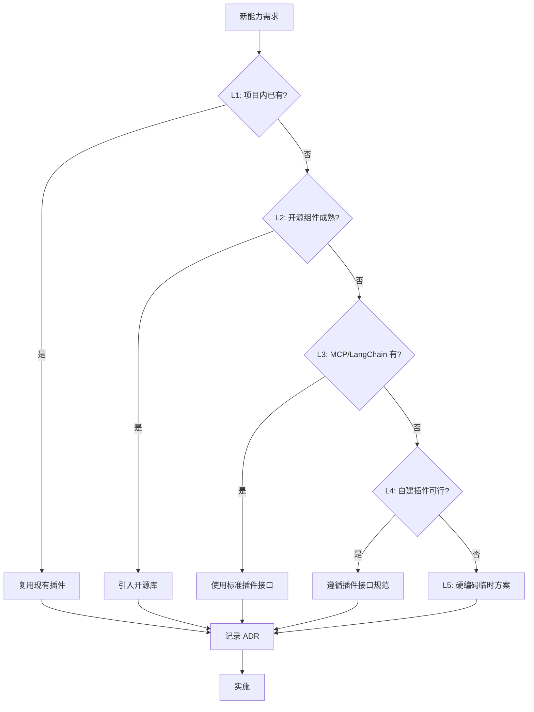

# 插件组装实施指南 v1.1.0

> **生成时间**: 2026-08-15
> **目标**: 指导 AI 和开发者如何按 L1-L5 层级评估并组装开源组件
> **配套**: 插件清单标准见 `docs/guides/plugin-manifest-standard.md`；组合配置见 `cordis.yaml`；注册表见 `plugins/registry.yaml`

---

## 〇、插件架构入口

整体架构参考 DeepSeek Harness"一切皆插件"理念，技能/规则/命令/Agent 均为插件：

| 文件 | 作用 |
|------|------|
| `cordis.yaml` | 组合配置 — 定义当前模式与插件启用状态 |
| `presets/standard.yaml` | 日常开发模式（全量插件） |
| `presets/minimal.yaml` | 快速模式（仅核心闭环） |
| `presets/creator.yaml` | 创建者模式（全量 + 安全验证强化） |
| `plugins/registry.yaml` | 插件注册表 — 全量目录与依赖关系 |
| `schemas/plugin-interface.jsonschema` | 插件接口契约 |
| `hooks/scripts/plugin-validator.py` | 清单合规校验（RULE-043） |

**组装新能力时**：按 L1-L5 评估 → 若引入新插件，在 `cordis.yaml` 声明启用、在 `plugins/registry.yaml` 登记、在 frontmatter 补全插件清单。

---

## 一、快速决策流程



---

## 二、可观测性栈选型（示例）

### 需求：Agent 运行可观测性

| 层级 | 方案 | License | 成熟度 | 优势 | 劣势 | 推荐度 |
|------|------|---------|--------|------|------|--------|
| L1 | 无 | — | — | — | — | ❌ |
| L2 | **OpenTelemetry Python** | Apache-2.0 | ⭐⭐⭐⭐⭐ | 行业标准，生态完整 | 需后端（Jaeger/Tempo） | ✅ **首选** |
| L2 | **structlog** | Apache-2.0 | ⭐⭐⭐⭐⭐ | 结构化日志，轻量 | 无 Trace 能力 | ✅ **必选** |
| L3 | MCP Tracing Server | MIT | ⭐⭐⭐ | 标准化接口 | 生态不成熟 | ⚠️ 评估 |
| L4 | 自研 Trace 系统 | MIT | — | 完全可控 | 维护成本高 | ❌ |
| L5 | print() 打点 | — | — | 快速实现 | 不可查询 | ❌ |

### 决策结果（示例 ADR）

```markdown
# ADR-001: 可观测性栈选型

## 背景
Agent 运行需要 Trace、Metrics、Logging 能力，支持调试和性能分析。

## 决策
选择 **L2 层级**方案：
- **OpenTelemetry Python** (Trace + Metrics)
- **structlog** (Logging)

## 理由
1. OpenTelemetry 是 CNCF 毕业项目，行业标准
2. structlog 是 Python 生态最成熟的日志库
3. 两个方案均 MIT/Apache-2.0 License，无合规风险
4. 社区活跃，维护者 ≥ 50 人

## 组装 vs 修改
- **方式**: 组装
- **说明**: 通过 SDK 集成，无需修改核心代码

## 后果
- 正面：可观测性完整，支持分布式追踪
- 负面：需部署 Jaeger/Tempo 后端
- 风险：学习曲线中等
```

---

## 三、工作流引擎选型（示例）

### 需求：ADLC 六阶段自动化编排

| 层级 | 方案 | License | 成熟度 | 优势 | 劣势 | 推荐度 |
|------|------|---------|--------|------|------|--------|
| L1 | 无 | — | — | — | — | ❌ |
| L2 | **Prefect** | Apache-2.0 | ⭐⭐⭐⭐⭐ | 生产级，支持重试/回调/状态管理 | 学习曲线陡峭，个人项目可能过重 | ⚠️ 评估 |
| L2 | **Luigi** | Apache-2.0 | ⭐⭐⭐⭐ | Spotify 出品，简单轻量 | 社区活跃度下降 | ⚠️ 评估 |
| L3 | 自研状态机 | MIT | — | 完全可控 | 维护成本高 | ❌ |
| L4 | 手动触发 | — | — | 无成本 | 无自动化 | ❌ |
| L5 | 硬编码脚本 | — | — | 快速实现 | 不可维护 | ❌ |

### 决策结果

**短期（< 3 个月）**: 保持现状，手动触发 ADLC 流程

**中期（≥ 3 个月）**: 评估 Prefect，当工作流复杂度超过 5 个阶段时引入

**长期**: 如引入 Prefect，采用以下架构：
```
plugins/
├── workflow/
│   ├── interface.py      # 工作流接口定义
│   ├── prefect_adapter.py # Prefect 适配层
│   └── luigi_adapter.py  # Luigi 适配层（备选）
└── adlc/
    ├── flow.py           # ADLC 工作流定义
    └── gates.py          # 阶段门禁检查
```

---

## 四、插件接口规范（L4 自建插件）

当 L1-L3 均不可行时，遵循以下规范自建插件：

### 4.1 目录结构

```
plugins/
├── {plugin-id}/
│   ├── __init__.py       # 插件注册入口
│   ├── interface.py      # 接口定义（TypeScript/Python）
│   ├── impl.py           # 实现逻辑
│   ├── config.yaml       # 插件配置
│   └── tests/
│       └── test_plugin.py
```

### 4.2 Python 接口定义

```python
# plugins/{plugin-id}/interface.py
from abc import ABC, abstractmethod
from dataclasses import dataclass
from typing import Any, Dict, List, Optional

@dataclass
class PluginConfig:
    """插件配置"""
    id: str
    name: string
    version: str
    enabled: bool = True
    dependencies: List[str] = None
    config: Dict[str, Any] = None

class BasePlugin(ABC):
    """插件基类"""
    
    @property
    @abstractmethod
    def id(self) -> str:
        pass
    
    @property
    @abstractmethod
    def name(self) -> str:
        pass
    
    @abstractmethod
    def initialize(self, config: PluginConfig) -> None:
        """初始化插件"""
        pass
    
    @abstractmethod
    def execute(self, context: Dict[str, Any]) -> Any:
        """执行插件逻辑"""
        pass
    
    @abstractmethod
    def teardown(self) -> None:
        """清理插件资源"""
        pass
```

### 4.3 插件注册

```python
# plugins/{plugin-id}/__init__.py
from .impl import MyPluginImpl
from .interface import BasePlugin

def register(context: PluginRegistry) -> None:
    """注册插件"""
    plugin = MyPluginImpl()
    context.register(plugin.id, plugin)
```

---

## 五、组装 vs 修改决策表

| 场景 | 方式 | 示例 |
|------|------|------|
| 需要新能力，已有插件满足 | **组装** | `cordis.yaml` 启用 `web-search` 插件 |
| 需要配置现有插件 | **组装** | `cordis.yaml` 修改 `fs-local.allowed_roots` |
| 需要新增能力，无现有插件 | **L4 自建插件** | 创建 `plugins/my-feature/` |
| 需要修改现有插件行为 | **修改** | 修改 `plugins/fs-local/impl.py` |
| 一次性脚本，无复用价值 | **L5 硬编码** | 临时数据迁移脚本 |

> **强制规则**：优先组装，禁止修改。仅在 L1-L3 均不可行时允许 L4/L5。

---

## 六、License 合规检查清单

引入新依赖前，执行以下检查：

- [ ] License 在白名单中（MIT/Apache-2.0/BSD/MPL/ISC/Unlicense）
- [ ] License 不在黑名单中（AGPL-3.0/SSPL/BSL/GPL-未隔离）
- [ ] 商业使用是否允许
- [ ] 修改源代码是否需要开源（Copyleft）
- [ ] 分发二进制是否需要开源（Copyleft）
- [ ] 专利授权是否明确（Apache-2.0 有，MIT 无）

---

## 七、后续行动

### 立即执行
1. ✅ 规则已更新（RULE-042 插件组装优先）
2. ✅ ADR 模板已定义
3. ⏳ 创建 `plugins/` 目录结构（下次需求时）

### 未来需求时
1. 可观测性栈选型（OpenTelemetry + structlog）
2. 工作流引擎选型（Prefect/Luigi）
3. 插件化改造试点（3 个技能）

---

## 附录：开源组件速查表

| 能力 | 推荐方案 | License | GitHub Stars |
|------|---------|---------|-------------|
| 可观测性-Trace | OpenTelemetry Python | Apache-2.0 | 30k+ |
| 可观测性-Metrics | Prometheus Client | Apache-2.0 | 20k+ |
| 结构化日志 | structlog | Apache-2.0 | 4k+ |
| 工作流-轻量 | Luigi | Apache-2.0 | 10k+ |
| 工作流-生产 | Prefect | Apache-2.0 | 15k+ |
| 任务调度 | APScheduler | MIT | 3k+ |
| 文档系统 | MkDocs Material | MIT | 10k+ |
| 模型网关 | LiteLLM Proxy | MIT | 12k+ |
| Schema 校验 | jsonschema | MIT | 3k+ |
| 安全扫描 | Bandit | Apache-2.0 | 3k+ |
| Linter | Ruff | MIT | 25k+ |
| 格式化 | Black | MIT | 30k+ |
