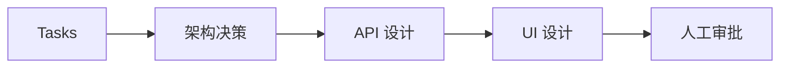
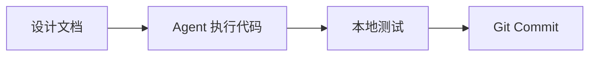

> **本文件落实**: RULE-041（模型网关接入 — v4.11.0 起为**项目级可选**，见下）

> **本文件定位（v4.2.0 纠偏）**：本文件是**阶段级生命周期**定义（每阶段的门禁与产出物），
> 与 `rules/workflow-core.md` §6.1 的**步骤级 SOP**（谁在什么时机做什么）**两套并存、分层不合并**。
> 映射关系与「谁是主文档」见 `workflow-core.md` §6.1.3——其中 **Implement / Deploy / Maintain 三阶段以本文件为主文档**，
> 其余阶段以 `workflow-core.md` 为主。本文件**不是**独立流程真源：改流程顺序前先看那张映射表，
> 不要在两处各改一半。
>
> **下方「核心规则」表的 RULE-034~040 全部已废弃**（v4.0.0 个人开发者适配），保留仅为历史对照；
> 本文件**当前唯一在册的规则编号是 RULE-041**。

> **RULE-041 决策出口（v4.2.0 补）**：RULE-041 是项目级可选，但**决策必须有人做、且不得默认视为已启用**——
> - 项目 `tech-stack.md` **声明**「统一模型网关」→ 该项目在自身 pre-commit / CI 启用 `hooks/scripts/model_gateway_lint.py`（`--ci` 阻断）；
> - 项目**未声明** → 允许直接使用模型 SDK，不扫描、不阻断；
> - 项目**没有 `tech-stack.md`**（当前 `<repo-a>`、`<repo-b>` 即是）→ 按「未声明」处理，
>   并把「补 `tech-stack.md` + 显式声明与否」登记为该仓待决项（`docs/00-系统现状.md` 的待确认字段），
>   **不得因为没人声明就默认启用或默认禁用**；
> - 全局 `hooks/hooks.json` 已移除 `model-gateway-gate.py`（文件仍在 `hooks/scripts/` 下，未挂载）。

## RULE-041: 模型网关接入（项目级，非全局强制）

> **v4.11.0（ADR-006）**：是否需要"统一模型网关"是**项目架构决策**，由该项目在 `tech-stack.md` 中声明，不再由全局钩子对所有项目阻断直连 SDK。
>
> - 项目声明"统一模型网关"：由该项目在自身 pre-commit / CI 启用 `hooks/scripts/model_gateway_lint.py`（`--ci` 阻断）。
> - 未声明：允许直接使用模型 SDK，不扫描、不阻断。
> - 全局 `hooks/hooks.json` 已移除 `model-gateway-gate.py`。

## 核心规则

| 编号 | 规则 | Enforcement 路径 |
|------|------|------------------|
| RULE-034 | ~~Agent 可观测性强制规范~~ | **已废弃**，使用现有 call_logs/ |
| RULE-035 | ~~Session Replay 强制记录~~ | **已废弃**，使用对话历史 + 调用日志 |
| RULE-036 | ~~特性旗标强制关联~~ | **已废弃**，使用环境变量开关 |
| RULE-037 | ~~渐进式发布强制要求~~ | **已废弃**，直接部署 |
| RULE-038 | ~~Agent 可编程控制 Flag~~ | **已废弃** |
| RULE-039 | ~~Workspace 后端选择规范~~ | **已废弃**，直接使用 MCP 工具 |
| RULE-040 | ~~多 Agent 协作协议~~ | **已废弃**，单 Agent 模式 |

### 已废弃规则

| 废弃编号 | 废弃原因 |
|---------|---------|
| RULE-034~038 | 依赖企业基础设施（OpenTelemetry/FeatureFlagService/WorkflowEngine） |
| RULE-039~040 | 个人单 Agent 模式不需要分布式协作 |

---

## 简化后的 ADLC 六阶段

### 阶段 1: Plan（需求分解）


**产出物**: `docs/tasks/<id>/plan.md` + `tasks.md`（v4.16.0 起按 RULE-055；旧 `docs/tasks/TASK-<YYYYMMDD>-<seq>.md` 扁平文件为历史存量，不再新建）

**强制要求**:
- [ ] 每个 Task 有明确验收标准
- [ ] 依赖关系清晰标注
- [ ] 预估工作量（人时）

---

### 阶段 2: Design（架构设计）



**产出物**:
- `docs/decisions/ADR-*.md`（架构决策记录，仅架构级选型）
- `docs/designs/YYYY-MM-DD-<slug>-design.md`

**强制要求**:
- [ ] 新 API 端点有 Pydantic Schema
- [ ] 数据库变更有 Alembic Migration
- [ ] 涉及多模块变更需架构图

---

### 阶段 3: Implement（代码实现）



**强制要求**:
- [ ] 遵循 TDD: RED→GREEN→REFACTOR
- [ ] 代码通过 Linter（ruff + eslint）
- [ ] 严禁硬编码密钥（RULE-008）

---

### 阶段 4: Test（测试验证）


**强制要求**:
- [ ] 新增功能有对应测试用例
- [ ] 测试覆盖率 ≥ 60%（个人项目降低要求）
- [ ] 所有测试通过才可提交

---

### 阶段 5: Deploy（部署发布）


**简化后流程**:
1. `docker compose up -d` 直接部署
2. 人工验证核心功能
3. `git tag v1.x.x` 标记版本

**取消的功能**:
- ~~灰度发布（1% → 25% → 100%）~~
- ~~Feature Flag 开关控制~~
- ~~自动回滚机制~~

---

### 阶段 6: Maintain（运维监控）


**简化后监控手段**:
- 调用日志：`call_logs/` 目录
- 应用日志：`logging` + `structlog`
- 错误追踪：手动检查 + Sentry（可选）

**取消的功能**:
- ~~OpenTelemetry Span 追踪~~
- ~~Session Replay~~
- ~~Agent SLO 监控~~
- ~~Span 消耗超限阻断~~

---

## 强制执行路径

### 必须执行的门禁

> **现状（v4.2.0 纠偏）**：本表列的是**阶段级必须通过项**，不是"当前唯一的门禁"。
> 共享规则库层面已挂载且**已在各仓 pre-commit 生效**的是：仓根洁净（`root-cleanliness-check.mjs`）
> 与规则一致性（`rules-consistency-check.py`）；项目自身的 lint / typecheck / test 由各仓 CI 承担
> （如 `<repo-a>`、`<repo-b>` 的 `ci.yml` 跑 tsc + vitest）。**下表是阶段级验收清单，不是门禁现状表**；
> 门禁现状真源见 `rules/cicd-rules.md` 的「门禁现状」节与 `hooks/configs/gate-inventory.yaml`。

| 门禁 | 工具 | 触发时机 |
|------|------|---------|
| Linter 检查 | 项目已配置的 ruff / eslint（以项目配置为准） | 手动或 CI；见 `rules/agent-constraints.md`（RULE-028） |
| 测试通过 | 项目已配置的测试栈（pytest / vitest） | 手动 / CI（可选） |
| 安全扫描 | bandit 或项目等价物 | 手动（同上） |
| Schema 校验 | Pydantic / 项目等价物 | 代码提交前手动执行 |

### 可选的执行门禁

| 门禁 | 工具 | 说明 |
|------|------|------|
| CI 流水线 | GitHub Actions | 个人项目可省略 |
| 自动部署 | Makefile | 建议保留 |
| 版本标记 | git tag | 必须执行 |

---

## 与 v3.x 的主要差异

| 差异项 | v3.x | v4.0（个人版） |
|--------|------|---------------|
| 可观测性 | OpenTelemetry + Jaeger | **call_logs/ + 结构化日志** |
| 会话重放 | Session Replay 表 | **对话历史 + 日志文件** |
| 灰度发布 | 1%/25%/100% 三阶段 | **直接部署 + 人工验证** |
| 特性旗标 | FeatureFlagService API | **环境变量开关** |
| Workspace | 抽象层 + 分布式锁 | **直接使用 MCP 工具** |
| 多 Agent | 完整协作协议 | **单 Agent + sub-agent** |
| Span 监控 | 强制全覆盖 | **无需** |
| SLO 阻断 | Agent 服务质量监控 | **无需** |

---

## 个人开发者 ADLC 精简清单

```markdown
- [ ] Plan: 生成 tasks.md，人工确认范围
- [ ] Design: 架构决策记录（ADR），API Schema，DB Migration
- [ ] Implement: TDD + Linter 检查 + 无硬编码密钥
- [ ] Test: 测试覆盖率 ≥ 60%，所有测试通过
- [ ] Deploy: Docker Compose 部署，git tag 标记版本
- [ ] Maintain: 日志监控，Bug 修复，性能优化
```
