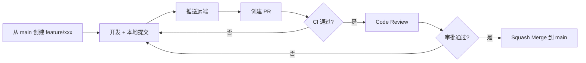
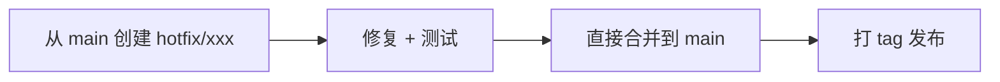

# 分支策略 (Branch Strategy)
> **与 `rules/git-conventions.md` 共同落实**: RULE-012（不要直接修改 main/master 分支）——本文件是策略展开与模板，**不单独声明 RULE-012 的编号落点**（落点以 `plugins/registry.yaml` 为准，登记为 `git-conventions.md`）；
> 本文件**不声明**其他 RULE 编号（原 RULE-020 已随 v4.0.0 废弃，见 §4 发布流程注）。

> **适用范围**: 通用分支策略，适用于所有项目。项目特定覆盖见项目根目录 `tech-stack.md` / `AGENTS.md`；**项目级 `AGENTS.md` 的分支纪律优先于本模板**（见下方 §0）。
>
> **对齐**: 本文件是 RULE-012（不直接修改 main/master）的完整落地，与 `git-conventions.md` 的分支规范互补。

## 0. 项目覆盖优先（2026-11-12 修订）

本文件是**通用模板**，`§核心决策` 与 `§3 合并策略` 的 Squash Merge / 线性历史 / 分支 ≤3 天 / 默认不用 `release/` 均为**未声明覆盖时的默认值**。当项目级 `AGENTS.md`（或 `tech-stack.md`）给出更严格的分支纪律时，**以项目级为准**，本模板不覆盖、不冲突声明。

已登记的覆盖（实测）：

| 项目 | 覆盖来源 | 覆盖内容 |
| --- | --- | --- |
| `<repo-a>` | `ai/AGENTS.md:20-24` + `ai/.githooks/pre-receive` | 单主干 `main` **只接受 `--no-ff` 合并提交（≥2 父）**；短命分支活 ≤1–2 天、合完即删；合并前必跑 `tools/pre-merge-check.ps1`；`release/*` / `backup/*` / `hotfix/*` 为受保护分支（`ai/tools/gc-branches.ps1:61-69`） |

> **口径说明**：Squash Merge 产生单父提交，与 `pre-receive` 的「尖端须 ≥2 父」直接冲突。因此在已启用该钩子的项目里，**必须**用 `git merge --no-ff`；`§2.1 步骤 7` 与 `§3 表格` 在这些项目下不适用。

## 0.1 主检出权与合并操作台（2026-11-14 增补，v1.2.0；起因：11-10~11-14 主检出被 4 分支接力占用 4 天、24 次 commit-tree 绕行实证）

多代理并发下，**主检出（非 worktree 的检出目录）的检出权是稀缺单点**。条款：

1. **主检出默认停在主干**（`main`/`master`）。把主检出切到任何开发分支前，必须声明「仍在外 + 改动文件清单」；任务收尾（各仓 AGENTS.md「收工节拍（四步）」）**必须归还**——切回主干，或把工作移交专用 worktree。
2. **main 合并操作台**：需要检出 main 做合并时，用专用 worktree（`git worktree add <path> main`，**用完即删**）；主检出被他人占用时，允许 plumbing 合并（`git merge-tree --write-tree` + `commit-tree` 双父提交 + `update-ref` CAS 推进），**合并提交体必须注明原因**（与本仓 `--no-verify` 理由同款留痕）。
3. **降摩擦（让合规路径可行，比堵绕行更有效）**：大仓全量检出不可行时，允许 `git worktree add --no-checkout <path> -b <branch> main` 后按需 `git checkout <分支> -- <路径>` 物化局部文件，配合 sparse-checkout 窄化。
4. **占用仲裁**：发现主检出停在非主干分支且超过一个收工周期，接手代理的第一动作是**先归还**（收尾或移交），不得接力占用。
5. **豁免计量**：`--no-verify` / commit-tree 类豁免**同日同因 ≥3 次**即视为门禁或流程缺陷信号，当日修复根因或在交付说明登记整改项；计量由 `hooks/scripts/branch-hygiene-check.mjs`（观察期 WARN）与每日指标取数承载。

## 核心决策

个人项目**默认采用 GitHub Flow 轻量模型**（单主干 + 短生命周期 Feature 分支 + PR），理由：

| 维度 | 选择 | 理由 |
|------|------|------|
| 模型 | GitHub Flow | 个人/小团队快速迭代，无历史包袱 |
| 默认分支 | `main` | 单一事实来源，始终可部署 |
| 分支生命周期 | ≤ 3 天 | 短分支降低合并冲突 |
| 合并方式 | Squash Merge（**未声明覆盖时的默认值**） | 保持 main 历史线性整洁；已启用 `--no-ff` 闸门的项目改用 `git merge --no-ff`，见 §0 |
| 发布方式 | Tag + main 直发 | 无独立 release 分支，个人项目 PRD 轻量 |

> 若项目需要固定版本节奏（如对外发布、多环境），升级为 GitLab Flow 的 release 分支模式；若团队 > 5 人且强 CI，可迁移 Trunk-Based。**默认不启用 GitFlow** 的重型五分支模型。

### 分支即环境映射（显式声明）

| 分支/Tag | 对应环境 | 说明 |
|----------|---------|------|
| `main` | **线上生产环境** | main 始终可部署，是线上版本的单一事实来源 |
| `main` 上的 `vX.Y.Z` tag | **线上发布版本** | tag 即线上版本号，与 `.deployed.json` 的 `version` 字段对齐 |
| `feature/`、`fix/`、`hotfix/` | 开发/测试环境 | 合并到 main 前不视为线上版本 |

> **对齐**: 此映射与 `cicd-rules.md` 的 CD 自动部署（tag 触发）及 `deploy-records.md` 的 `.deployed.json` 版本记录保持一致——「main 上的 tag = 线上版本」。

---

## 1. 分支类型

| 分支 | 前缀 | 来源 | 合并到 | 生命周期 | 是否推送远端 |
|------|------|------|--------|---------|-------------|
| 主分支 | `main` | — | — | 永久 | 是 |
| 功能分支 | `feature/` | main | main | ≤ 3 天 | 是 |
| 修复分支 | `fix/` | main | main | 短 | 是 |
| 紧急修复 | `hotfix/` | main | main + tag | 极短 | 是 |
| 实验分支 | `experiment/` | main | 可丢弃 | 临时 | 可选 |

> **禁止类型**：`release/`、`develop/`（个人项目默认不使用，避免多长期分支维护成本）。若确需，需在 ADR 中记录理由。

---

## 2. 分支流转规范

### 2.1 功能开发流程（feature）

| 步骤 | 动作 | 规范 |
|------|------|------|
| 1 | 创建分支 | `git checkout -b feature/xxx`，从最新 main 创建 |
| 2 | 开发提交 | 遵循 Conventional Commits，单逻辑单元一提交 |
| 3 | 推送 | 推送远端，便于协作与备份 |
| 4 | 创建 PR | 变更量 ≤ 400 行，描述含变更/影响/测试方式 |
| 5 | 门禁 | 合并前手动执行 `bash rules/gate.sh`；四仓当前无 CI 接入规则门禁（见 `cicd-rules.md §门禁现状`） |
| 6 | 审批 | Code Review 通过后合并 |
| 7 | 合并 | **优先 Squash Merge**（默认；已启用 `--no-ff` 闸门的项目改用 `git merge --no-ff`，见 §0），合并后删除 feature 分支 |

### 2.2 紧急修复流程（hotfix）

| 步骤 | 动作 | 规范 |
|------|------|------|
| 1 | 创建分支 | `git checkout -b hotfix/xxx`，从 main |
| 2 | 修复 | 最小变更，必须补测试（RULE-003） |
| 3 | 合并 | 可跳过 PR 审批，但必须本地测试通过 |
| 4 | 打 tag | 合并后立即 `git tag vX.Y.Z` 并推送 |

---

## 3. 合并策略

> **默认表（仅当项目未声明覆盖时适用，见 §0）**。已启用 `--no-ff` 闸门的项目（`<repo-a>`）整节以 `git merge --no-ff` 为准。

| 场景 | 合并方式（默认） | 说明 |
|------|---------|------|
| 功能分支 | Squash Merge | 压缩为单提交，main 历史线性 |
| 多协同分支 | Rebase Merge | 多人协作时保持线性历史 |
| 紧急修复 | Direct Merge | 保持提交粒度 |

> **项目覆盖**：若项目级 `AGENTS.md` 要求 `main` 只接受 `--no-ff` 合并提交，则本节三种方式**均不适用**（Squash / Rebase 都产生单父提交，会被服务端 `pre-receive` 拒绝）。此时统一 `git merge --no-ff <branch>`，并保留合并提交作为集成记录。

---

## 4. 版本发布策略

个人项目采用 **Tag 驱动发布**：

| 版本号 | 语义 | Tag 示例 |
|--------|------|---------|
| MAJOR | 破坏性变更 | `v2.0.0` |
| MINOR | 向后兼容新功能 | `v2.1.0` |
| PATCH | Bug 修复 | `v2.1.1` |

发布流程：
1. 功能合并到 main 后，累计到可发布状态
2. `git tag vX.Y.Z` 打标签
3. 推送 tag 触发项目自建 CI/CD（四仓当前均未配置 `cd-production.yml`，需按项目补齐）
4. 更新 `.deployed.json`（推荐，非强制）

> **无独立 release 分支**：个人项目直接由 main 上的 tag 发布。若需同时维护多个线上版本，才引入 release 分支。
> > **关于 `.deployed.json`**：原 RULE-020（Tag 发布后更新部署清单）已随 v4.0.0 个人开发者适配废弃；
> 此处保留该操作作为**可选最佳实践**（有 `.deployed.json` 便于快速查询线上版本，无则用 `git tag -l` 同样可查），
> **不再引用废弃编号**。

---

## 5. 与既有规则的关系

| 规则 | 关系 |
|------|------|
| RULE-012 | 本文件是其在分支策略层面的完整落地 |
| `git-conventions.md` | 本文件补充其分支**流转生命周期**，两者互补 |
| `cicd-rules.md` | 分支合并触发 CI 门禁 |
| RULE-020 | ~~Tag 发布后更新 `.deployed.json`~~ | 推荐非强制（见上） |

---

## 6. 禁止事项

> 本节为**未声明项目覆盖时的默认禁止项**（见 §0）。已登记覆盖：`<repo-a>` 分支生命周期为 ≤1–2 天；`release/*` / `backup/*` / `hotfix/*` 在该仓是**受保护分支**（`ai/tools/gc-branches.ps1:61-69`）；该仓 `main` 的合并提交是集成记录而非噪音，不得按本条禁止。

- ❌ 直接提交到 `main`（RULE-012）
- ❌ 默认使用 `release/`、`develop/` 多长期分支（**默认**，项目可覆盖）
- ❌ 功能分支存活超过 3 天不合并（**默认**，项目可覆盖为 1–2 天）
- ❌ 合并产生大量 merge commit 噪音（**默认**，采用 `--no-ff` 集成的项目除外）
- ❌ 跳过 CI 强制合并
- ❌ 分支命名使用下划线或驼峰（违反 `git-conventions.md`）