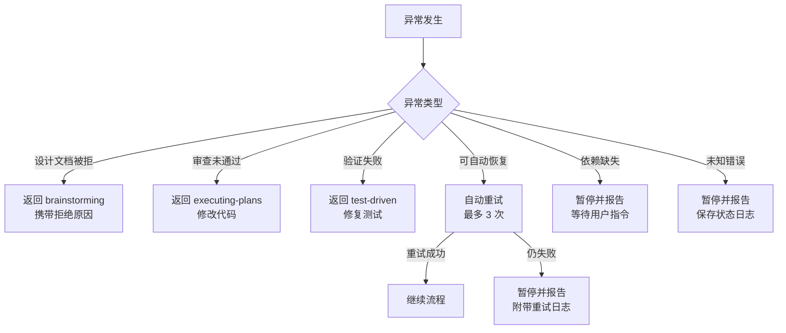

# 异常处理流程 (Exception Handling)

## 异常分类处理



| 异常场景 | 责任主体 | 处理动作 | 回退目标 |
|----------|----------|----------|----------|
| 设计文档被用户拒绝 | `brainstorming` | 重新探索需求，迭代设计 | P1 (brainstorming) |
| 代码审查未通过 | `code-reviewer` | 提出修改意见，开发者修复 | P4 (executing-plans) |
| 测试验证失败 | `test-engineer` | 分析失败原因，修复测试或代码 | P5 (test-driven) |
| 数据库迁移失败 | `database-expert` | 回滚迁移，修复脚本 | P4 (executing-plans) |
| 构建/部署失败 | `backend-developer` | 检查日志，修复配置或代码 | P4 (executing-plans) |
| **可自动恢复**（网络超时、服务临时不可用、测试偶发失败） | AI 代理 | **自动重试，最多 3 次，间隔递增（5s/15s/30s）**；仅限**幂等/可重入**的读取或查询操作，禁止对写操作（POST/PUT/DELETE、DB 迁移、支付）盲目重试 | — |
| 依赖缺失或外部服务故障 | AI 代理 | **暂停并上报**，等待用户指令 | — |
| 未知错误或系统异常 | AI 代理 | **暂停并上报**，保存完整状态日志 | — |

## 标准异常响应模板

```text
[异常报告]
- 发生位置: <步骤/技能/文件>
- 异常类型: <错误分类>
- 错误信息: <详细描述>
- 影响范围: <阻塞/非阻塞>
- 建议处理: <AI 的建议>
- 等待用户: <approve / reject / instruction>
```
