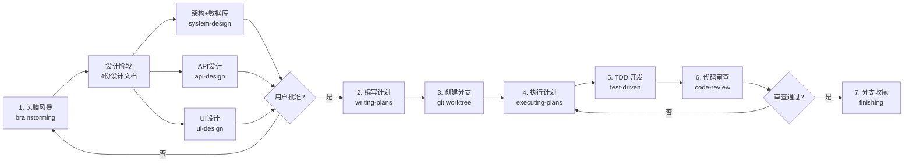

# 核心工作流概览 (Workflow Core)

## 6.0 项目全流程概览 (P0–P10，核心阶段 P1–P8)

```mermaid
graph LR
    P0[0. 项目启动<br/>project-initiation] --> P1[1. 需求探索<br/>brainstorming]
    P1 --> P1D[1.5 设计阶段<br/>system-design + api-design + ui-design]
    P1D --> P2[2. 编写计划<br/>writing-plans]
    P2 --> P4[4. 执行计划<br/>executing-plans]
    P4 --> P5[5. TDD 开发<br/>test-driven]
    P5 --> P5S[5.5 测试策略<br/>test-strategy]
    P5S --> P6[6. 代码审查<br/>code-review]
    P6 --> P7[7. 分支收尾<br/>finishing]
    P7 --> P8[8. 部署上线<br/>deploy]
    P8 --> P9[9. 运维监控<br/>ops-monitoring]
    P9 --> P10[10. 项目收尾<br/>project-closure]
```



| 阶段 | 触发技能 | 输出产物 | 适用场景 |
|------|----------|----------|----------|
| 0 | `project-initiation` | `docs/project-initiation.md` | 新项目启动 |
| 1 | `brainstorming` | `docs/designs/*-design.md` | 功能需求探索 |
| 1.5 | `system-design` / `api-design` / `ui-design` + 按需扩展 | `docs/architecture.md` + `database-schema.md` + `api-design.md` + `ui-wireframe.md` | 设计阶段 |
| 2 | `writing-plans` | 实施计划（对话中输出） | 任务拆解 |
| 4 | `executing-plans` | 代码实现 | 逐步实现 |
| 5 | `test-driven` | 测试通过 | 单元测试 |
| 5.5 | `test-strategy` | `docs/test-plan.md` + `docs/test-report.md` | 系统级测试 |
| 6 | `code-review` | 审查通过 | 质量把关 |
| 7 | `finishing` | 合并/清理 | 分支收尾 |
| 8 | `deploy` | 生产环境部署 | 部署上线 |
| 9 | `ops-monitoring` | `docs/ops-manual.md` | 运维监控 |
| 10 | `project-closure` | 验收/复盘报告 | 项目收尾 |

> **阶段 0 和 9-10 为可选**：个人项目可跳过，直接从阶段 1 开始。
>
> **与硬性规则对应**：阶段 1 触发 RULE-001（brainstorming）；阶段 1.5→2 之间设 RULE-002 审批门禁（设计文档未批准禁止写代码）；阶段 4–5 落实 RULE-003（TDD）；阶段 8 前完成 RULE-004 验证与 RULE-016 安全检查。下方 §6.1 是阶段 1.5 设计子流程的展开，二者编号一致，无需另记。
>
> **阶段 4 的并行执行**：进入 `executing-plans` 后，若计划中的任务**互不依赖**，按 `rules/collaboration.md` §2.5「最大并行度子智能体执行」**以最大可用并行度派发子智能体**；共享文件独占区与同一 worktree 的写入必须串行收口。

## 6.1 软件开发生命周期 (7 步闭环)



**技能衔接说明：**

| 步骤 | 触发技能 | 负责代理 | 输出产物 | 衔接规则 |
|------|----------|----------|----------|----------|
| 1 | `brainstorming` | `architect` | `docs/designs/*-design.md` | 自动执行 |
| 1.5a | `system-design` | `architect` | `architecture.md` + `database-schema.md` | 并行 |
| 1.5b | `api-design` | `backend-developer` | `api-design.md` | 依赖架构设计 |
| 1.5c | `ui-design` | `frontend-developer` | `ui-wireframe.md` | 并行 |
| 1.5d | **用户审批** | — | — | 全部批准后进入步骤2 |
| 2 | `writing-plans` | `architect` | 实施计划（对话输出） | 自动触发 |
| 3 | `git worktree` | — | 独立工作分支 | 手动触发 |
| 4 | `executing-plans` | 按任务分配 | 代码实现 | 按 plan 执行 |
| 5 | `test-driven` | `test-engineer` | 测试通过 | 嵌入步骤4 |
| 6 | `code-review` | `code-reviewer` | 审查通过 | 每单元完成后 |
| 7 | `finishing` | — | 合并/清理 | 全部完成后 |

> **v1.3.0 变更（ADR-008，规范驱动开发）**：步骤 1.5d 的审批门禁现在同时覆盖
> **规格（spec）**——L2/L3 任务在步骤 2 之前产出 `docs/tasks/<id>/spec.md`（模板
> `templates/spec/spec-template.md`），与四份设计文档同批审批。spec 是**功能级唯一真源**
> （WHAT/WHY + 编号需求），四份设计文档写系统形态与选型；实现依据以 spec 为准。
> 规则定义见 `rules/spec-driven.md`（RULE-055）与 `rules/spec-kit.md`（RULE-056），
> L0/L1 不落盘规格（`rules/collaboration.md` 分级表）。

**代理自动分配规则：**

| 任务类型 | 自动分配代理 | 适用条件 |
|----------|-------------|----------|
| 后端 API / 服务逻辑 | `backend-developer` | 涉及 Router / Service / Repository 层 |
| 前端组件 / 页面 | `frontend-developer` | 涉及 React 组件 / TypeScript |
| 数据库 Schema 变更 | `database-expert` | 涉及 Model 修改 / Alembic 迁移 |
| 安全认证 / 加密 | `security-auditor` | 涉及 Auth / 加密 / 权限控制 |

## 6.1.1 MVP 快速启动路径

```
Day 1: 需求澄清 → 技术选型确认 → 单份 design.md（≤2页）
Day 2-3: 核心功能编码
Day 4: 自测 + 部署验证 + 收集反馈
Week 2+: 基于反馈迭代，按需补充文档
```

## 6.1.2 按需拆分规则

| 场景 | 简化方案 |
|------|----------|
| 纯前端组件 | 跳过 architecture + database-schema，保留 api-design + ui-wireframe |
| 纯后端接口 | 跳过 ui-wireframe，保留 architecture + database-schema + api-design |
| MVP 快速验证 | 核心四文档合并为单份 design.md，扩展文档全部跳过 |
| Bug 修复/小优化 | 所有文档均可跳过，直接进入 writing-plans |

## 6.1.3 与 ADLC 六阶段的映射（两套并存，分层不合并）

> 本文件 §6.1 的七步是**步骤级 SOP**（谁在什么时机做什么、触发哪个技能），`rules/adlc-lifecycle.md` 的六阶段是**阶段级生命周期**（每个阶段的门禁与产出物）。两套并存，按此映射执行，不做合并；归属列决定「谁是主文档」（主文档保留完整正文，另一方只引用）。
> 同一件事不同粒度 = 内容可互相推导，只是拆分粒度不同；确实不同 = 一方有、另一方没有，需各自保留。

| workflow-core 步骤 | adlc 阶段 | 对应关系 | 文档归属 |
|--------------------|-----------|----------|----------|
| 1 头脑风暴 + 1.5 四份设计文档（brainstorming → system-design / api-design / ui-design，含用户审批门禁） | Plan（需求分解，产出 tasks.md）+ Design（ADR / design.md） | **同一件事不同粒度**：七步把 ADLC 的 Plan+Design 展开成「先探索、再出四份设计文档、再审批」；ADLC 用两阶段概括，且把 tasks.md 放在 Design 之前 | workflow-core 为主（步骤级）；adlc 引用 |
| 2 编写计划（writing-plans，输出实施计划） | Plan 的 tasks.md 落地 | **同一件事不同粒度**（不等价）：ADLC tasks.md 是需求分解产物，七步的实施计划是任务排期与执行序 | workflow-core 为主 |
| 3 创建分支（git worktree） | 无（ADLC 未单列工作区/分支动作） | **确实不同**：分支与工作区管理只在七步里 | workflow-core 为主；adlc 在 Implement 前置处引用 |
| 4 执行计划（executing-plans） | Implement（代码实现） | **同一件事不同粒度** | adlc 为主（阶段定义）；workflow-core 提供执行细则 |
| 5 TDD 开发（test-driven，嵌入第 4 步） | Implement 的写测试 + Test 的验收 | **同一件事不同粒度**：七步把 TDD 单列并内嵌执行，ADLC 拆到 Implement/Test 两阶段 | workflow-core 为主（TDD 细则）；adlc 引用 |
| 6 代码审查（code-review，每单元完成后） | Test 阶段末尾「人工验收」+ 质量门 | **同一件事不同粒度**：ADLC 未把 code review 显式列为阶段 | workflow-core 为主；adlc 引用 |
| 7 分支收尾（finishing：合并/清理） | 无（ADLC 从「测试通过」直接进 Deploy） | **确实不同**：合并与清理只在七步里 | workflow-core 为主 |
| （无对应步骤） | Deploy（部署发布：docker compose + git tag） | **确实不同**：七步闭环止于分支收尾，不含部署 | adlc 为主；workflow-core §6.0 P8 与 `cicd-rules.md` 引用 |
| （无对应步骤） | Maintain（运维监控：日志 / Bug 修复 / 性能） | **确实不同**：七步闭环不含运维 | adlc 为主；workflow-core §6.0 P9 引用 |

**使用口径**：进入一个任务时看七步（步骤级，决定下一步做什么）；判断是否满足阶段门禁时看 ADLC（阶段级，决定能不能继续）。两套结论冲突时，以本表「文档归属」列的主文档为准。
