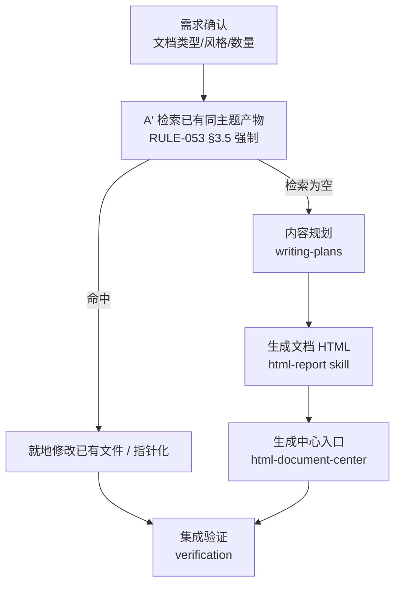

# HTML 文档生成工作流 (HTML Document Workflow)
> **本文件落实**: RULE-006（HTML 文档生成使用 html-document-center 技能）

> HTML 文档生成是**并行流程**，不阻塞开发周期。可在项目任意阶段触发。

## 设计文档 vs HTML 文档

| 类型 | 路径 | 受众 | 用途 | 是否阻塞 |
|------|------|------|------|----------|
| **设计文档** | `docs/designs/*.md` | 开发者 | 编码前置条件，含 HOTL 合约 | 是 |
| **HTML 文档** | `docs/html/*.html` | 用户/团队 | 阅读展示，不参与审批 | 否 |

## 流程

## 主流程 x HTML 流程交叉点

| 交叉点 | 主流程阶段 | HTML 流程阶段 | 行为 | 依赖方向 |
|--------|-----------|--------------|------|----------|
| A | brainstorming | 需求确认 | 设计文档转 HTML 展示 | 主→文档 |
| **A′** | **—（生成前门禁）** | **检索已有同主题产物** | 已有文档中心模板 / 索引 / 正文真源 → 就地修改，不新建第二套视觉体系 | 规则→文档 |
| B | executing-plans | 生成文档 HTML | 代码完成后生成 API 文档 | 主→文档 |
| C | finishing | 生成中心入口 | 项目完成后汇总所有文档 | 主→文档 |
| D | — | 集成验证 | 验证 API 示例与实际一致 | 文档→主 |

> **关键规则**：HTML 文档流不阻塞主开发流；主开发流不等待 HTML 文档流。交叉点 D 例外：API 文档示例必须与实际接口一致。

### 生成前查重（v1.1.0 新增，唯一真源 RULE-053 §3.5）

1. **先找模板**：检索目标仓 / 工作区里是否已有文档中心 HTML、既有 CSS 变量体系、导航与 TOC 实现。命中即**在该文件上改**，不得另起一套视觉体系。
2. **先找正文**：检索同主题 Markdown / 报告。Markdown 是内容真源，HTML 只是导航与索引层，用 `fetch` / 链接加载，**不得内嵌第二份正文**；旧模板里内嵌的项目快照 JSON 属历史数据，不迁移。
3. **判定留痕**：在 `docs-author` 输入契约的「查重结论」里写清检索路径、命中文件、判定（就地修改 / 指针化 / 新建及理由）。
4. **门禁**：观察期 `node hooks/scripts/duplicate-artifact-check.mjs --root <repo> --check`（WARN only）；冻结仓 / `archive/` / `_worktrees/` / `staged/` 派生片段按 §3.5 属合法例外。
