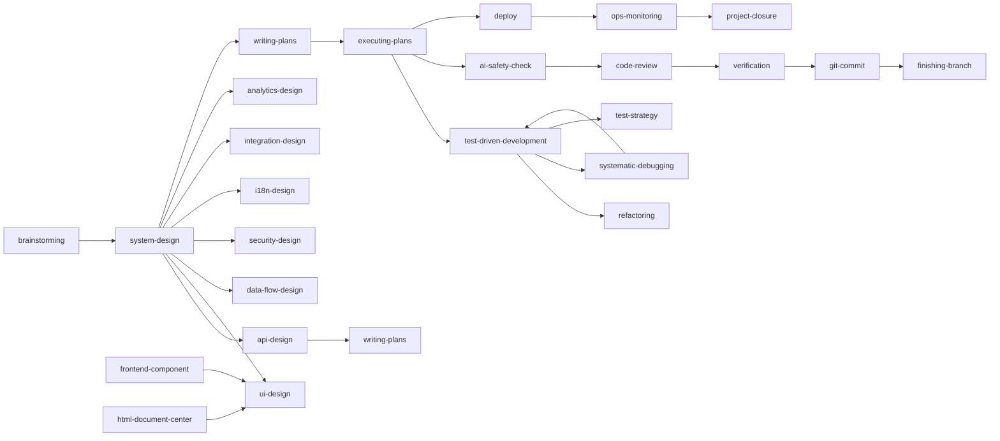

# Skills 组合路由索引

> **目的**：落实 AGENTS.md 上下文预算原则——禁止全量读取 `skills/`，Agent 通过 `depends_on` 依赖图按需加载，避免上下文超限。
> **原则**：每个技能在 frontmatter 中声明 `depends_on`（前置依赖）与 `composes`（可组合的下游）。
> **插件化**：技能即插件（RULE-042/043），全量注册表见 `plugins/registry.yaml`，组合配置见 `cordis.yaml`，清单标准见 `docs/guides/plugin-manifest-standard.md`。

## 加载规则

1. 触发某技能时，仅加载该技能 + 其 `depends_on` 链上的技能
2. 禁止一次读取全部 29 个技能
3. 组合调用时，按 `composes` 声明的顺序执行

## 技能依赖总图



## 技能清单与依赖

| 技能 | 负责代理 | depends_on (前置) | composes (下游) |
|------|---------|-------------------|-----------------|
| brainstorming | architect | — | system-design |
| system-design | architect | brainstorming | api-design, ui-design, data-flow-design, security-design, i18n-design, integration-design, analytics-design, writing-plans |
| api-design | backend-developer | system-design | database-migration, writing-plans |
| ui-design | ui-designer | system-design | frontend-component, html-document-center |
| data-flow-design | architect | system-design | writing-plans |
| security-design | security-auditor | system-design | ai-safety-check |
| i18n-design | ui-designer | system-design | frontend-component |
| integration-design | backend-developer | system-design | writing-plans |
| analytics-design | backend-developer | system-design | writing-plans |
| database-migration | database-expert | api-design | — |
| frontend-component | frontend-developer | ui-design | — |
| html-document-center | docs-author | ui-design | — |
| writing-plans | architect | system-design, api-design | executing-plans |
| executing-plans | orchestrator | writing-plans | test-driven-development, ai-safety-check, deploy |
| test-driven-development | test-engineer | executing-plans | refactoring, systematic-debugging, test-strategy |
| test-strategy | test-engineer | test-driven-development | — |
| ai-safety-check | security-auditor | executing-plans | code-review |
| code-review | code-reviewer | ai-safety-check | verification |
| verification | verifier | code-review | finishing-branch |
| git-commit | all | verification | finishing-branch |
| finishing-branch | all | git-commit, verification | — |
| refactoring | architect | test-driven-development | — |
| systematic-debugging | test-engineer | test-driven-development | — |
| performance-tuning | architect | — | — |
| deploy | backend-developer | executing-plans | ops-monitoring |
| ops-monitoring | devops | deploy | project-closure |
| project-closure | architect | ops-monitoring | — |
| project-initiation | architect | — | brainstorming |
| writing-skills | all | — | — |

## 主流程路由

一条完整开发流程的技能调用链：

```
project-initiation
    → brainstorming → system-design → (api-design | ui-design | data-flow-design | security-design | ...)
        → writing-plans → executing-plans
            → test-driven-development → refactoring / systematic-debugging / test-strategy
            → ai-safety-check → code-review → verification
            → deploy → ops-monitoring → project-closure
```

## 禁止事项

- ❌ 禁止一次性加载全部 29 个技能
- ❌ 禁止跳过 `depends_on` 前置技能直接调用下游（如未经 `code-review` 直接 `verification`）
- ❌ 禁止跨主流程调用（如设计阶段直接调 `deploy`）

## 不采用项记录（YAGNI 决策）

以下热榜项目经评估后**明确不采用**，记录理由避免重复评估（RULE-015）：

| 项目 | 领域 | 不采用理由 |
|------|------|-----------|
| block/buzz | 多 Agent 实时协作通信 | 个人开发场景下多 Agent 实时协作是过度设计（YAGNI），RULE-040 协议层已够用 |
| open-design | AI 设计工具 | 与 UI 规则弱相关，Local-first 设计不改变规则体系 |
| Vibe-Trading | 金融量化 Agent | 领域无关，不进入通用开发规则 |
| ai-agent-book | Agent 原理教材 | 仅作 `skills/` 培训参考，不直接改规则 |

> 若未来出现团队协作或多 Agent 实时通信需求，重新评估 block/buzz 类方案。