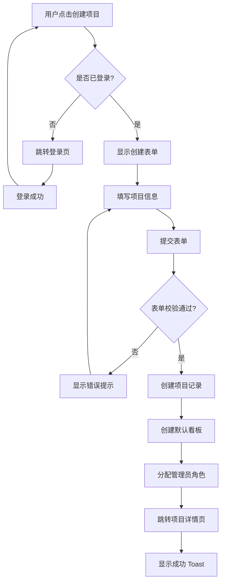
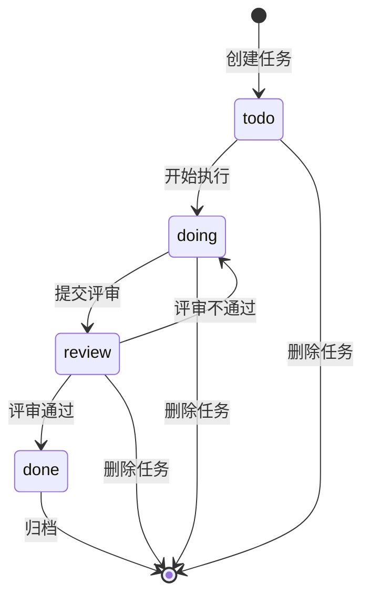
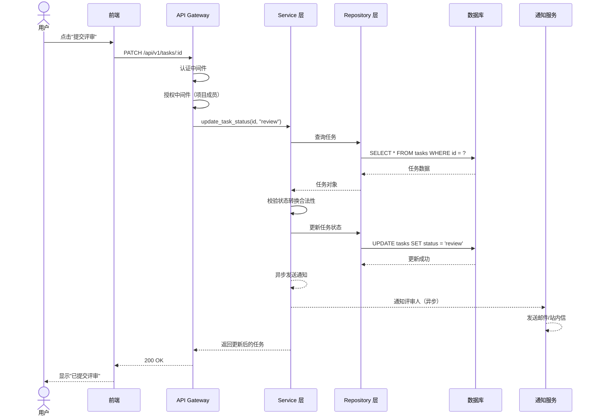
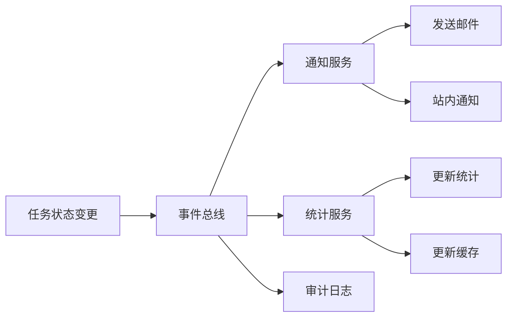
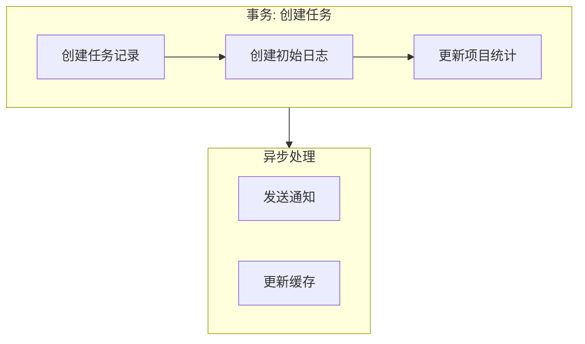
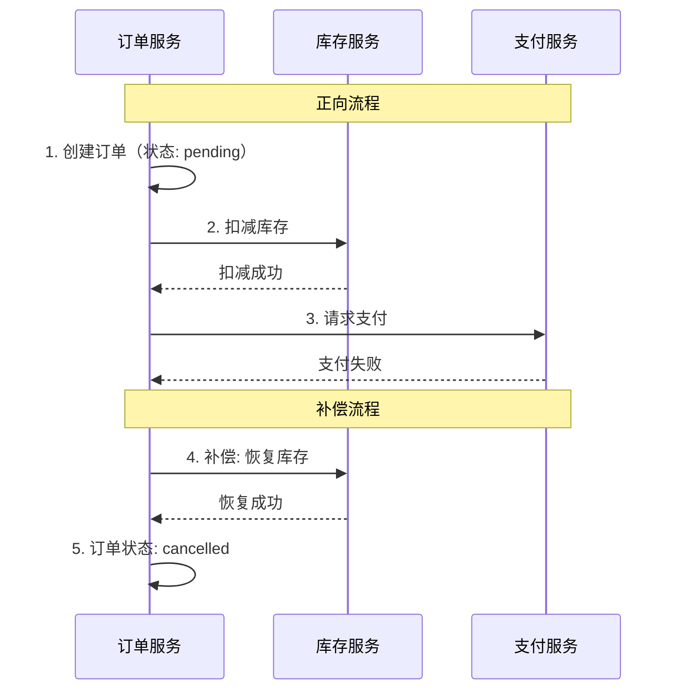

# Data Flow Design


## 负责代理

`architect` — 数据流与状态设计由架构师代理负责，确保业务流程完整、状态机正确。

## 何时使用

- 需要梳理**核心业务流程**（超过 3 个步骤的操作链）时
- 需要设计**实体状态机**（有生命周期的实体，如订单、任务、审批）时
- 需要绘制**时序图**（跨模块/跨服务的交互流程）时
- 需要设计**事件驱动架构**（异步处理、消息队列、WebSocket 推送）时
- 需要定义**数据一致性策略**（事务边界、Saga 补偿、最终一致性）时
- 涉及**分布式事务**或**异步处理链**时

**触发关键词**: "数据流"、"状态机"、"时序图"、"业务流程"、"事件驱动"、"Saga"、"异步处理"、"补偿事务"、"状态转换"

## 与其他技能的关系

```
brainstorming → system-design → api-design
                     ↓              ↓
              data-flow-design ←────┘
                     ↓
              writing-plans → executing-plans
```

> **衔接规则**:
> - `data-flow-design` 依赖 `system-design` 的架构设计（模块划分、技术选型）和数据库设计（实体定义）
> - `data-flow-design` 与 `api-design` / `ui-design` **并行执行**
> - `data-flow-design` 的状态机必须与 `database-schema.md` 中的枚举值一致
> - `data-flow-design` 的时序图必须与 `api-design` 的接口调用顺序一致
> - `data-flow-design` 的数据流必须与 `ui-design` 的页面交互流程一致

## 设计阶段总体流程

```
需求确认 → 架构设计 → 数据流设计 → API设计 → UI设计
              ↑           ↓          ↓
              └─── 互相校验、迭代调整 ──┘
```

**输出文件清单**:

```
docs/
├── architecture.md          ← 架构设计（system-design 技能输出）
├── database-schema.md       ← 数据库设计（system-design 技能输出）
├── data-flow-design.md      ← 数据流设计（本技能输出）
├── api-design.md            ← 接口设计（api-design 技能输出）
├── ui-wireframe.md          ← UI/页面设计（ui-design 技能输出）
```

> **校验关系**: 数据流设计中的状态机 → 数据库设计中的枚举值；时序图 → API 接口调用顺序；数据流 → UI 页面交互流程，三者必须一致。

---

## 执行流程

### Phase 1: 核心业务流程梳理

**目标**: 全面梳理所有业务场景，识别关键路径和异常路径。

#### Step 1: 业务场景清单

从 `brainstorming` 输出的需求文档中提取所有业务场景：

```markdown
## 业务场景清单

| 编号 | 场景名称 | 触发条件 | 参与角色 | 涉及模块 | 复杂度 |
|------|----------|----------|----------|----------|--------|
| F-01 | 用户注册 | 用户点击注册 | 用户 | Auth, User | 低 |
| F-02 | 用户登录 | 用户输入凭证 | 用户 | Auth | 低 |
| F-03 | 创建项目 | 用户点击新建 | 用户 | Project | 中 |
| F-04 | 邀请成员 | 管理员邀请 | 管理员, 成员 | Project, User | 中 |
| F-05 | 任务状态流转 | 用户拖拽/点击 | 用户 | Task | 高 |
| F-06 | 批量导入数据 | 用户上传文件 | 用户 | Task, File | 高 |
| F-07 | 支付流程 | 用户下单 | 用户 | Order, Payment | 高 |
| F-08 | 数据导出 | 用户请求导出 | 用户 | Task, File | 中 |
```

> **复杂度判定**: 低 = 单模块、<= 3 步骤；中 = 多模块、4-6 步骤；高 = 多模块、异步、> 6 步骤或涉及外部服务。

#### Step 2: 流程图绘制

为每个复杂度 >= 中 的场景绘制流程图（使用 Mermaid flowchart）：



**流程图必须覆盖**:
- 正常流程（Happy Path）
- 主要异常流程（校验失败、权限不足、网络超时）
- 分支条件（角色判断、状态判断）
- 回退路径（取消操作、返回上一步）

---

### Phase 2: 状态机设计

**目标**: 为有生命周期的实体定义完整的状态机。

#### Step 3: 识别有状态实体

从 `database-schema.md` 中识别需要状态管理的实体：

| 实体 | 状态字段 | 状态数量 | 说明 |
|------|----------|----------|------|
| 任务 | status | 4 | todo / doing / review / done |
| 订单 | status | 5 | pending / paid / shipped / completed / cancelled |
| 审批 | status | 4 | draft / submitted / approved / rejected |
| 用户 | status | 3 | active / suspended / deleted |

#### Step 4: 状态机定义

使用 Mermaid stateDiagram-v2 为每个有状态实体绘制状态图：



#### Step 5: 状态转换规则表

| 当前状态 | 目标状态 | 触发条件 | 前置校验 | 副作用 |
|----------|----------|----------|----------|--------|
| todo | doing | 用户点击"开始" | 任务分配到当前用户 | 记录开始时间 |
| doing | review | 用户点击"提交" | 关联了至少 1 个产出物 | 通知评审人 |
| review | done | 评审人点击"通过" | 当前用户是评审人 | 记录完成时间 |
| review | doing | 评审人点击"驳回" | 当前用户是评审人 | 记录驳回原因 |

**状态转换规则要素**:
- **当前状态**: 转换前的状态
- **目标状态**: 转换后的状态
- **触发条件**: 谁/什么事件触发转换
- **前置校验**: 转换前必须满足的条件
- **副作用**: 转换后产生的其他影响（通知、日志、关联操作）

#### Step 6: 非法转换定义

明确定义不允许的状态转换：

| 禁止转换 | 原因 |
|----------|------|
| done → todo | 已完成任务不可回退到待办 |
| done → doing | 已完成任务不可重新开始 |
| todo → done | 必须经过 doing 和 review |
| cancelled → paid | 已取消订单不可直接支付 |

> **实现提示**: 在 Service 层使用枚举校验状态转换的合法性，禁止直接修改状态字段。

---

### Phase 3: 时序图设计

**目标**: 为关键交互流程绘制时序图，明确同步/异步调用边界。

#### Step 7: 时序图绘制

为每个核心业务场景绘制时序图（使用 Mermaid sequenceDiagram）：



**时序图必须覆盖**:
- 正常流程（Happy Path）：如上
- 异常流程（Error Path）：校验失败、权限不足、数据库异常
- 异步调用边界：明确标注哪些是异步（`-->>` 虚线箭头）
- 外部服务交互：标注第三方服务的调用

#### Step 8: 同步 vs 异步决策

| 场景 | 推荐方式 | 理由 |
|------|----------|------|
| 数据 CRUD | 同步 | 用户需要即时反馈 |
| 发送通知 | 异步 | 不阻塞主流程 |
| 文件处理 | 异步 | 处理时间不可控 |
| 支付确认 | 同步 + 异步回调 | 同步返回结果，异步处理回调 |
| 批量导入 | 异步 | 大数据量处理 |
| 数据导出 | 异步 | 生成文件耗时 |
| 搜索查询 | 同步 | 用户需要即时结果 |
| 报表生成 | 异步 | 查询复杂耗时 |

---

### Phase 4: 事件驱动设计

**目标**: 定义事件模型和发布/订阅架构，支持异步解耦。

#### Step 9: 事件定义

**事件模型**:

```json
{
  "event_id": "uuid",
  "event_type": "task.status_changed",
  "timestamp": "2026-07-24T10:00:00Z",
  "source": "task-service",
  "payload": {
    "task_id": "uuid",
    "old_status": "doing",
    "new_status": "review",
    "changed_by": "user-uuid",
    "project_id": "uuid"
  },
  "metadata": {
    "correlation_id": "uuid",
    "version": "1.0"
  }
}
```

**事件清单**:

| 事件类型 | 触发时机 | 发布者 | 订阅者 |
|----------|----------|--------|--------|
| `user.registered` | 用户注册成功 | Auth Service | 通知服务、分析服务 |
| `task.status_changed` | 任务状态变更 | Task Service | 通知服务、统计服务 |
| `project.member_added` | 新增项目成员 | Project Service | 通知服务、权限服务 |
| `file.uploaded` | 文件上传完成 | File Service | 处理服务、通知服务 |
| `order.paid` | 支付成功 | Payment Service | 订单服务、通知服务、物流服务 |
| `export.completed` | 数据导出完成 | Export Service | 通知服务 |

#### Step 10: 发布/订阅模型

**架构选择**:

| 方案 | 适用场景 | 复杂度 | 个人项目推荐 |
|------|----------|--------|-------------|
| **应用内事件** | 单进程、事件量小 | 低 | 首选（初期） |
| **Redis Pub/Sub** | 轻量级、可接受丢失 | 低 | 可接受丢失的场景 |
| **RabbitMQ** | 需可靠交付、复杂路由 | 中 | 需可靠性的场景 |
| **Kafka** | 高吞吐、事件溯源 | 高 | 数据量大的场景 |

**事件处理链**:



#### Step 11: 事件处理保证

| 保证级别 | 说明 | 实现方式 |
|----------|------|----------|
| **至少一次** | 事件可能重复，但不会丢失 | 确认机制 + 重试 |
| **幂等处理** | 重复事件不产生副作用 | 事件 ID 去重 |
| **顺序保证** | 同一实体的事件按序处理 | 分区键（entity_id） |
| **死信队列** | 处理失败的事件进入死信 | 重试 3 次后转入 DLQ |

---

### Phase 5: 数据一致性设计

**目标**: 定义事务边界和分布式一致性策略。

#### Step 12: 事务边界定义

**单体应用事务边界**:



**事务原则**:
- 同一聚合根的操作在同一事务中
- 跨聚合根的操作通过事件最终一致
- 外部服务调用放在事务外

#### Step 13: Saga 补偿事务

**适用场景**: 跨服务的分布式事务（如订单创建 + 库存扣减 + 支付）

**Saga 模式选择**:

| 模式 | 说明 | 适用场景 |
|------|------|----------|
| **编排式（Choreography）** | 各服务通过事件驱动，独立执行和补偿 | 简单流程、服务少 |
| **协调式（Orchestration）** | 中心协调器控制执行顺序和补偿 | 复杂流程、需集中管理 |

**Saga 补偿示例（订单创建）**:



**补偿策略**:

| 步骤 | 正向操作 | 补偿操作 | 补偿失败处理 |
|------|----------|----------|-------------|
| 创建订单 | INSERT order | UPDATE order SET status='cancelled' | 人工介入 |
| 扣减库存 | UPDATE stock -= 1 | UPDATE stock += 1 | 记录异常，人工处理 |
| 请求支付 | 调用支付 API | 调用退款 API | 记录异常，人工处理 |

#### Step 14: 最终一致性策略

| 策略 | 说明 | 适用场景 |
|------|------|----------|
| **事件驱动同步** | 通过事件异步同步数据 | 跨服务数据同步 |
| **定时任务补偿** | 定时扫描不一致数据并修复 | 对实时性要求不高的场景 |
| **读取修复** | 读取时检测不一致并修复 | 容忍短暂不一致 |
| **版本向量** | 使用版本号检测冲突 | 分布式数据同步 |

---

### Phase 6: 输出 data-flow-design.md

文件保存到 `docs/data-flow-design.md`:

```markdown
# 数据流设计: [项目名称]

## 1. 核心业务流程
### 1.1 业务场景清单
### 1.2 业务流程图（Mermaid flowchart）

## 2. 状态机设计
### 2.1 有状态实体清单
### 2.2 状态机图（Mermaid stateDiagram）
### 2.3 状态转换规则表
### 2.4 非法转换定义

## 3. 时序图
### 3.1 关键交互时序图（Mermaid sequenceDiagram）
### 3.2 同步/异步调用决策表

## 4. 事件驱动设计
### 4.1 事件定义与清单
### 4.2 发布/订阅模型
### 4.3 事件处理链

## 5. 数据一致性
### 5.1 事务边界定义
### 5.2 Saga 补偿事务（如适用）
### 5.3 最终一致性策略
```

---

## 数据流设计检查清单

- [ ] 所有业务场景已列出（复杂度和参与角色已标注）
- [ ] 复杂度 >= 中 的场景已绘制流程图
- [ ] 流程图覆盖正常流程和异常流程
- [ ] 所有有状态实体已识别
- [ ] 每个有状态实体有完整的状态机图
- [ ] 状态转换规则表已定义（含前置校验和副作用）
- [ ] 非法状态转换已明确禁止
- [ ] 关键交互时序图已绘制
- [ ] 时序图覆盖同步和异步调用边界
- [ ] 同步/异步决策表已完成
- [ ] 事件定义和清单已完成
- [ ] 事件处理链已定义
- [ ] 事务边界已明确划分
- [ ] 跨服务 Saga 补偿策略已定义（如适用）
- [ ] 最终一致性策略已确定
- [ ] 状态枚举值与 database-schema.md 一致
- [ ] 时序图与 api-design.md 接口调用顺序一致
- [ ] 数据流与 ui-design.md 页面交互流程一致

## 硬性规则

- **业务流程超过 3 个步骤时必须设计数据流** — 步骤越多，异常路径越多
- **涉及异步处理时必须定义事件模型** — 事件是异步通信的契约
- **涉及分布式事务时必须定义补偿策略** — 没有补偿的分布式事务是不可靠的
- **所有有状态实体必须有状态机** — 不可隐式管理状态
- **状态转换必须校验合法性** — 在 Service 层强制校验，禁止直接修改状态字段
- **数据流必须与 API 设计和 UI 设计一致** — 三份文档的交互流程必须对齐
- **时序图必须覆盖异常流程** — 不能只画 Happy Path
- **事件必须包含唯一 ID 和版本号** — 用于幂等处理和版本兼容
- **外部服务调用必须在事务边界外** — 避免长事务锁表
- **所有异步操作必须有失败处理策略** — 重试/补偿/死信队列

## 反模式

- **禁止假设所有操作都是同步的** — 不区分同步/异步会导致超时和阻塞
- **禁止忽略失败场景** — 只设计正常流程，上线后异常满天飞
- **禁止跳过事务边界分析** — 数据不一致往往源于事务边界模糊
- **禁止"所有操作一个事务"** — 长事务锁表，影响并发性能
- **禁止事件无 ID 和版本号** — 无法去重，无法兼容升级
- **禁止状态直接赋值** — 必须通过状态机校验转换合法性
- **禁止时序图只有框框无文字** — 必须标注每个箭头的操作和返回数据
- **禁止忽略补偿失败的处理** — 补偿也可能失败，必须有兜底方案
- **禁止"以后再说"推迟数据流设计** — 事后补的数据流图往往是错的