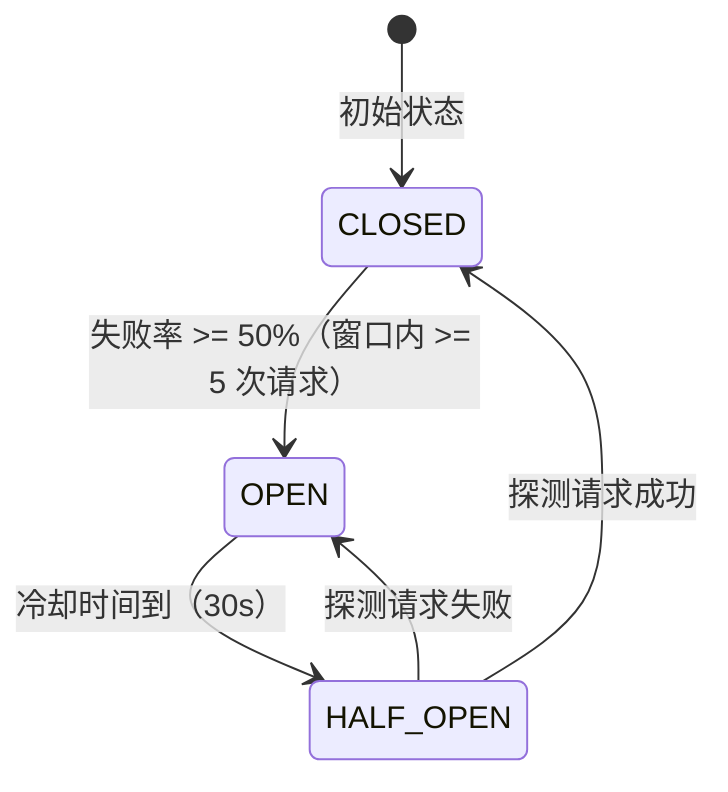

# 容错设计与 Webhook 参考（integration-design Phase 3-5 配套）

> 本文档按需加载。包含分层超时、指数退避重试、熔断器状态机、降级方案矩阵、Webhook 签名验证与幂等处理。

## Phase 3: 容错与重试设计

**目标**：确保外部服务异常时系统的稳定性和可用性。

### 超时设置

**分层超时策略**:

| 层级 | 超时时间 | 说明 |
|------|----------|------|
| 连接超时 | 3s | 建立 TCP 连接的最大等待时间 |
| 读取超时 | 10s | 等待响应的最大时间 |
| 总超时 | 15s | 整个请求的最大时间 |
| 用户感知超时 | 5s | 同步接口超过此时间需异步化 |

**各服务超时设置**（示例基线，按项目调整）:

| 服务 | 连接超时 | 读取超时 | 总超时 | 说明 |
|------|----------|----------|--------|------|
| 支付 | 3s | 10s | 15s | 支付超时后需查询确认 |
| 邮件 | 3s | 5s | 10s | 改为异步发送，不阻塞 |
| 短信 | 3s | 5s | 10s | 改为异步发送 |
| AI 推理 | 5s | 30s | 60s | 长耗时，必须异步 |
| 文件上传 | 5s | 30s | 60s | 大文件使用分片上传 |

### 重试策略

**指数退避重试**:

```python
# 重试参数配置
retry_config = {
    "max_retries": 3,           # 最大重试次数
    "backoff_factor": 2,        # 退避因子
    "initial_delay": 1,         # 初始延迟（秒）
    "max_delay": 30,            # 最大延迟（秒）
    "retry_on": [               # 可重试的错误
        "network_error",        # 网络错误
        "timeout",              # 超时
        "server_error",         # 5xx
        "rate_limit",           # 429
    ],
    "no_retry_on": [            # 不可重试的错误
        "bad_request",          # 400
        "unauthorized",         # 401
        "forbidden",            # 403
        "not_found",            # 404
    ]
}
```

**重试时序**:

```text
请求 1: 失败（网络错误）→ 等待 1s
请求 2: 失败（超时）     → 等待 2s
请求 3: 失败（500）      → 等待 4s
请求 4: 成功 或 放弃（达到 max_retries）
```

**各服务重试策略**:

| 服务 | 最大重试 | 退避策略 | 不可重试错误 |
|------|----------|----------|-------------|
| 支付 | 2 | 指数退避 2s/4s | 402（支付失败）、400（参数错误） |
| 邮件 | 3 | 指数退避 1s/2s/4s | 400（邮箱格式错误） |
| 短信 | 3 | 指数退避 1s/2s/4s | 400（手机号格式错误） |
| AI | 2 | 指数退避 2s/4s | 400（内容违规） |
| 文件存储 | 3 | 指数退避 1s/2s/4s | 400（文件格式错误） |

### 熔断器设计

**熔断器状态机**:



**熔断器参数**:

| 参数 | 默认值 | 说明 |
|------|--------|------|
| 失败阈值 | 50% | 窗口内失败率超过此值触发熔断 |
| 最小请求数 | 5 | 窗口内最少请求数，低于此值不触发 |
| 窗口大小 | 60s | 滑动窗口大小 |
| 冷却时间 | 30s | 熔断后等待多久进入半开状态 |
| 半开探测数 | 1 | 半开状态下允许的探测请求数 |

**各服务熔断配置**:

| 服务 | 失败阈值 | 冷却时间 | 说明 |
|------|----------|----------|------|
| 支付 | 50% | 60s | 支付是核心流程，保守冷却 |
| 邮件 | 71% | 30s | 邮件非核心，可快速恢复 |
| 短信 | 71% | 30s | 短信非核心 |
| AI | 50% | 120s | AI 服务成本高，保守冷却 |
| 文件存储 | 50% | 30s | |

### 降级方案

**降级策略矩阵**（示例基线）:

| 服务 | 降级方案 | 影响 | 用户感知 |
|------|----------|------|----------|
| 支付 | 暂不支持 X 支付方式，提示用户用其他方式 | 部分支付方式不可用 | 支付方式选择减少 |
| 邮件 | 邮件放入队列，延迟发送 | 邮件延迟 | 无感知（异步） |
| 短信 | 降级为邮件通知 | 时效性降低 | 收到邮件而非短信 |
| AI | 返回预设话术/缓存结果 | 智能程度降低 | 回复质量下降 |
| 文件存储 | 暂不支持上传，提示用户稍后重试 | 上传功能不可用 | 明确提示 |
| 第三方登录 | 仅支持邮箱密码登录 | 登录方式减少 | 登录方式选择减少 |

**降级优先级**:

```text
优先级 1（核心，不可降级）: 支付确认
优先级 2（重要，可短暂降级）: 邮件、短信
优先级 3（一般，可降级）: AI 功能、第三方登录
优先级 4（可选，可关闭）: 统计、推荐
```

## Phase 4: Webhook 设计

**目标**：设计可靠的 Webhook 接收和处理机制。

### Webhook 端点设计

**Webhook URL 规范**:

```text
https://api.example.com/webhooks/{provider}/{event}
示例:
- https://api.example.com/webhooks/stripe/payment-intent
- https://api.example.com/webhooks/github/push
- https://api.example.com/webhooks/sendgrid/delivered
```

**Webhook 端点清单**:

| 端点 | 来源 | 事件 | 处理方式 |
|------|------|------|----------|
| `/webhooks/stripe/payment-intent` | Stripe | 支付成功/失败 | 同步更新订单状态 |
| `/webhooks/stripe/subscription` | Stripe | 订阅变更 | 更新用户订阅状态 |
| `/webhooks/github/push` | GitHub | 代码推送 | 触发 CI/CD |
| `/webhooks/sendgrid/events` | SendGrid | 邮件送达/打开 | 记录邮件状态 |

### 签名验证

**必须实现签名验证**，防止伪造 Webhook 请求：

```python
import hmac
import hashlib

def verify_webhook_signature(
    payload: bytes,
    signature_header: str,
    secret: str,
    tolerance: int = 300  # 5 分钟容差
) -> bool:
    """
    验证 Webhook 签名。

    通用验证流程:
    1. 从 Header 中提取签名和时间戳
    2. 检查时间戳是否在容忍范围内（防重放攻击）
    3. 使用密钥计算期望签名
    4. 使用 hmac.compare_digest 比较（防时序攻击）
    """
    # 提取签名和时间戳（具体格式因服务商而异）
    # 计算期望签名
    expected = hmac.new(
        secret.encode(),
        payload,
        hashlib.sha256
    ).hexdigest()
    return hmac.compare_digest(expected, signature_header)
```

**各服务签名方式**:

| 服务 | 签名方式 | 签名头 | 密钥来源 |
|------|----------|--------|----------|
| Stripe | HMAC-SHA256 | `Stripe-Signature` | Webhook Secret |
| GitHub | HMAC-SHA256 | `X-Hub-Signature-256` | Webhook Secret |
| SendGrid | HMAC-SHA256 | `X-Twilio-Email-Event-Webhook-Signature` | Webhook Secret |
| 微信支付 | RSA 签名 | `Wechatpay-Signature` | 平台证书 |

### 幂等处理

**幂等处理策略**:

```python
async def process_webhook(event_id: str, event_type: str, payload: dict):
    """
    幂等处理 Webhook 事件。

    1. 检查 event_id 是否已处理
    2. 如未处理，执行业务逻辑
    3. 记录处理结果
    """
    # 使用数据库唯一约束保证幂等
    # INSERT INTO webhook_events (event_id, event_type, status)
    # VALUES (?, ?, 'processing')
    # ON CONFLICT (event_id) DO NOTHING
    pass
```

**幂等处理要素**:

| 要素 | 说明 |
|------|------|
| 唯一事件 ID | 每个 Webhook 事件必须有唯一 ID |
| 去重存储 | 数据库唯一约束 / Redis SETNX |
| 处理状态 | pending → processing → completed / failed |
| 重复检测 | 收到重复事件直接返回 200（已处理） |
| 超时重试 | 处理超过 30s 标记为 failed，等待重试 |

## Phase 5: 输出 integration-design.md

文件保存到 `docs/integration-design.md`，章节结构：

```markdown
# 集成设计: [项目名称]

## 1. 第三方服务清单
### 1.1 服务总览表
### 1.2 必要性评估
### 1.3 服务选型对比

## 2. 接口契约定义
### 2.1 服务 S-01: [服务名]
### 2.2 服务 S-02: [服务名]
### ...

## 3. 认证方式汇总
### 3.1 OAuth 2.0 集成流程

## 4. 容错与重试设计
### 4.1 超时设置
### 4.2 重试策略（含指数退避）
### 4.3 熔断器设计
### 4.4 降级方案

## 5. Webhook 设计
### 5.1 Webhook 端点清单
### 5.2 签名验证
### 5.3 幂等处理

## 6. 费用与限制
### 6.1 月度费用预估
### 6.2 Rate Limit 汇总
### 6.3 超限处理方案
```
