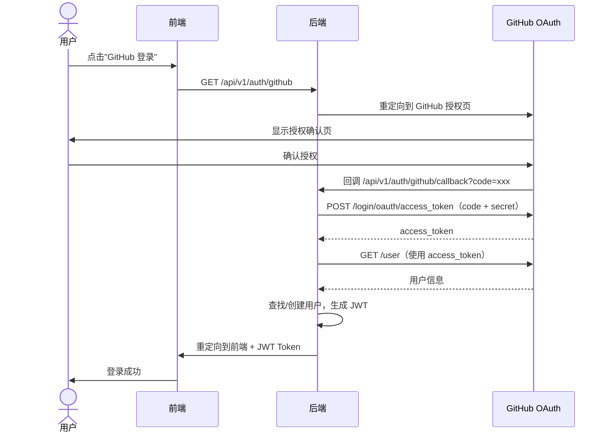

# 服务清单与接口契约参考（integration-design Phase 1-2 配套）

> 本文档按需加载。包含第三方服务清单模板、必要性评估矩阵、选型对比、接口契约模板、认证方式汇总与 OAuth 集成设计。

## Phase 1: 集成清单梳理

**目标**：全面盘点所有第三方服务，评估必要性、费用和风险。

### 第三方服务清单（示例基线，从 brainstorming 需求和 system-design 架构中提取）

```markdown
## 第三方服务清单

| 编号 | 服务名称 | 用途 | 是否必须 | 费用（预估） | 替代方案 | 风险等级 |
|------|----------|------|----------|-------------|----------|----------|
| S-01 | Stripe | 支付 | 是 | 2.9% + $0.30/笔 | LemonSqueezy, Paddle | 高 |
| S-02 | SendGrid | 邮件发送 | 是 | $19.95/月（100封/天免费） | Resend, AWS SES | 中 |
| S-03 | Twilio | 短信验证 | 否 | $0.0079/条 | 阿里云短信 | 中 |
| S-04 | GitHub OAuth | 第三方登录 | 否 | 免费 | — | 低 |
| S-05 | Google OAuth | 第三方登录 | 否 | 免费 | — | 低 |
| S-06 | OpenAI API | AI 功能 | 否 | 按 Token 计费 | Claude, 本地模型 | 中 |
| S-07 | Cloudflare R2 | 文件存储 | 是 | $0.015/GB/月 | AWS S3, MinIO | 低 |
| S-08 | Sentry | 错误监控 | 否 | 免费额度 | 自建 | 低 |
```

### 服务必要性评估

**评估维度**:

| 维度 | 问题 | 评分标准 |
|------|------|----------|
| **必要性** | 不用这个服务，功能能否实现？ | 1-5（5=不可替代） |
| **成本** | 用户量增长后费用是否可控？ | 1-5（5=成本可控） |
| **可靠性** | 服务 SLA 是否满足需求？ | 1-5（5=99.9%+） |
| **迁移成本** | 如果换服务商，迁移成本多高？ | 1-5（5=低成本） |
| **文档质量** | API 文档和 SDK 是否完善？ | 1-5（5=完善） |

**决策矩阵**:

| 总分 | 决策 |
|------|------|
| >= 20 | 直接采用 |
| 15-19 | 可以采用，但准备替代方案 |
| 10-14 | 需要评估替代方案 |
| < 10 | 不建议采用 |

### 服务选型对比（示例）

```markdown
| 维度 | Stripe | LemonSqueezy | Paddle |
|------|--------|-------------|--------|
| 手续费 | 2.9% + $0.30 | 5% + $0.50 | 5% + $0.50 |
| 支持地区 | 全球 46 国 | 全球 | 全球 |
| 中国用户支持 | 需境外卡 | 支持支付宝 | 支持支付宝 |
| MoR（代缴税） | 否 | 是 | 是 |
| 开发复杂度 | 中 | 低 | 低 |
| 个人开发者 | 支持 | 支持 | 需审核 |
| 决策 | **首选** | 备选（MoR 需求） | 备选（MoR 需求） |
```

## Phase 2: 接口契约定义

**目标**：为每个第三方服务定义清晰的接口契约，包括请求/响应格式、认证方式和限制。

### 接口契约模板

**每个第三方服务需定义**:

```markdown
### S-01: Stripe Payment

**服务信息**:
- 文档地址: https://stripe.com/docs/api
- SDK: `stripe` (Python), `@stripe/stripe-js` (前端)
- 环境: 沙箱 `sk_test_*` / 生产 `sk_live_*`

**认证方式**: Bearer Token（`Authorization: Bearer {api_key}`）

**核心接口**:

| 接口 | 方法 | 说明 | 超时 |
|------|------|------|------|
| 创建 PaymentIntent | POST /v1/payment_intents | 创建支付意图 | 5s |
| 确认 PaymentIntent | POST /v1/payment_intents/:id/confirm | 确认支付 | 10s |
| 退款 | POST /v1/refunds | 创建退款 | 10s |
| 查询 PaymentIntent | GET /v1/payment_intents/:id | 查询支付状态 | 3s |

**Rate Limit**:
- 沙箱: 25 次/秒
- 生产: 100 次/秒
- 处理方式: 429 响应时等待 Retry-After 指定时间后重试

**错误处理**:

| 错误码 | 类型 | 处理方式 |
|--------|------|----------|
| 400 | 参数错误 | 记录日志，返回用户友好提示 |
| 401 | 认证失败 | 检查 API 密钥，告警 |
| 402 | 支付失败 | 传递 Stripe 错误信息给用户 |
| 429 | 限流 | 等待 Retry-After 后重试 |
| 500 | 服务端错误 | 重试 3 次，仍失败则告警 |

**费用**:
- 费率: 2.9% + $0.30 每笔成功交易
- 退款: 不退手续费
- 国际卡: +1.5%
```

### 认证方式汇总

| 认证方式 | 示例服务 | 实现方式 | 注意事项 |
|----------|----------|----------|----------|
| API Key | Stripe, OpenAI | `Authorization: Bearer {key}` | 环境变量管理 |
| OAuth 2.0 | GitHub, Google | 授权码流程 + Token 交换 | State 参数防 CSRF |
| Basic Auth | Twilio (旧版) | `Authorization: Basic {base64}` | 仅 HTTPS |
| HMAC 签名 | 微信支付 | 请求签名 + 非对称加密 | 证书管理 |
| mTLS | 某些银行接口 | 客户端证书 | 证书轮换 |

### OAuth 集成设计

**OAuth 2.0 授权码流程**（以 GitHub 为例）:



**OAuth 安全要点**:

| 要点 | 说明 |
|------|------|
| State 参数 | 生成随机 state，验证回调中的 state 一致，防 CSRF |
| PKCE | 移动端/SPA 必须使用 PKCE 扩展 |
| Token 存储 | access_token 仅在服务端使用，不返回前端 |
| Scope 最小化 | 只请求必要的权限范围 |
| 账户关联 | 检测邮箱冲突，提供账户合并选项 |
